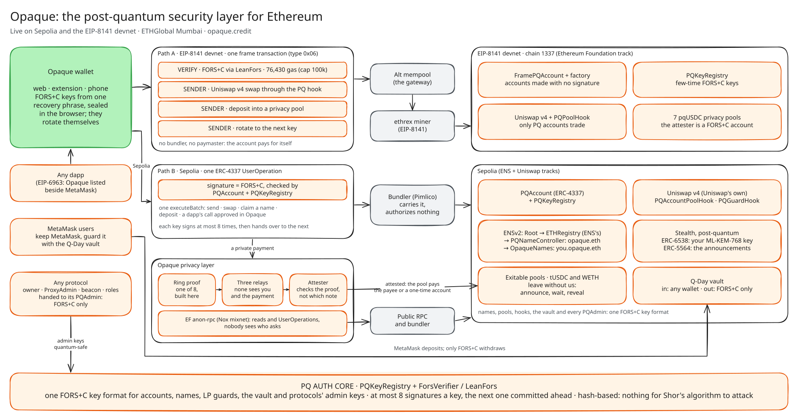
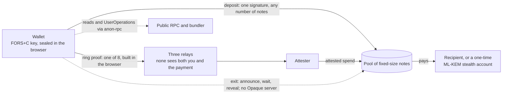

### Ethereum, private and post-quantum. Today, not on a roadmap.

**Opaque is a wallet in which everything an Ethereum user does is authorized by a hash-based, post-quantum key, and private by default:**
- paying and being paid;
- naming, swapping and providing liquidity;
- connecting to dapps, and keeping MetaMask.

It's live on Sepolia and on Ethereum's EIP-8141 devnet, built for ETHGlobal Mumbai.

[**Open the wallet**](https://www.opaque.credit/testnet/devnet) · [**ETHGlobal Mumbai submission**](docs/mumbai/README.md) · [What we built](https://www.opaque.credit/ethglobal-mumbai) · [Sepolia wallet](https://www.opaque.credit/sepolia/app) · [Keep MetaMask](https://www.opaque.credit/sepolia/vault) · [Opaque beside MetaMask](https://www.opaque.credit/connect-opaque) · [Partner evidence](partner-docs/README.md)

---

## Why this is the need of the hour

**1. Every Ethereum account that has ever signed has already published what a quantum computer needs.**
- An ECDSA signature reveals its public key, and from the public key, Shor's algorithm recovers the private key.
- When that becomes practical, every exposed account can be emptied by whoever runs the machine: every wallet, every LP position, every name.
- Ethereum's own plan for that day, Vitalik Buterin's 2024 "quantum emergency" hard fork, is a last resort. It would roll the chain back and freeze accounts, and users would prove ownership another way. An emergency plan isn't a product. Nobody should be waiting for it.

**2. Privacy built on elliptic curves has an expiry date, and it's already on chain.**
- Chain data is forever. A stealth payment hidden today with secp256k1 Diffie-Hellman (ERC-5564's scheme 1) can be opened by whoever breaks secp256k1, at any point in the future. Every announcement ever made becomes linkable at once.
- That's "harvest now, decrypt later", and on a public ledger nothing even needs harvesting.
- **Privacy that must still hold in ten years has to be post-quantum on the day the payment is made.**

**3. The cryptography is ready. Wallets aren't.**
- NIST standardized ML-KEM (FIPS 203) and hash-based signatures (FIPS 205) in August 2024.
- Published estimates of the hardware needed to break today's public-key cryptography keep falling: Gidney, 2025, RSA-2048 with under a million noisy qubits.
- Moving a user base takes years. **The cheapest time to move is before anyone has to.** Opaque lets people move now, without leaving Ethereum, without waiting for a fork, and without giving up MetaMask.

---

## What we built, live today

| You want to… | Opaque does it with… | Live on |
|---|---|---|
| **Pay privately** (USDC and ETH) | Pools of fixed-size notes. A hash-based ring proof shows you own one of 8 without saying which, sealed and carried by a three-hop relay mesh. ETH goes in as WETH notes. | Sepolia, devnet |
| **Be paid privately** | **Post-quantum stealth addresses**: an ML-KEM-768 meta-address in [ERC-6538](https://eips.ethereum.org/EIPS/eip-6538)'s registry, announcements on [ERC-5564](https://eips.ethereum.org/EIPS/eip-5564)'s Announcer. Each payment lands at a fresh FORS+C account only you can find, and the wallet sweeps it into your notes. | Sepolia |
| **Own a name** | **ENSv2**: opaque.eth is held by `PQNameController`, which acts only on a FORS+C signature. `name.opaque.eth` can be claimed only by post-quantum accounts, and then labels your account. → [ENS](partner-docs/ethglobal-mumbai/ens.md) | Sepolia |
| **Swap and provide liquidity** | **Uniswap v4 hooks**: pools only post-quantum accounts can use, and `PQGuardHook`, a FORS+C second factor that protects *any* LP's position, MetaMask's included. → [Uniswap](partner-docs/ethglobal-mumbai/uniswap.md) | Sepolia (Uniswap's v4), devnet |
| **Keep MetaMask** | **The Q-Day vault**: your ECDSA key puts money in, and only your FORS+C key takes it out. | [Sepolia](https://www.opaque.credit/sepolia/vault) |
| **Use any dapp** | **Connect with Opaque**: an EIP-6963 provider, so dapps list Opaque beside MetaMask. Every transaction is approved in Opaque and signed by the post-quantum account. | [Sepolia](https://www.opaque.credit/connect-opaque) |
| **Read without being watched** | EF's **anon-rpc** (the Nox mixnet), always for ENS, and for the whole account with one switch. | Sepolia |
| **Leave without us** | **Exitable pools**: every note can leave its pool with every Opaque server down, through anon-rpc and a public bundler. → [EF](partner-docs/ethglobal-mumbai/ethereum-foundation.md) | Sepolia |
| **Sign with nothing but a hash-based key** | **EIP-8141 frame transactions**: the account validates with FORS+C in its VERIFY frame and pays for itself, at 76,430 gas, under the public mempool's 100k budget. No bundler, no paymaster. | [Devnet](https://www.opaque.credit/testnet/devnet) |

On Sepolia, each action is a UserOperation signed by the account's FORS+C key, and a bundler only carries it. On the EIP-8141 devnet, the transaction itself is post-quantum.

## How a private payment works

- **Keys:** FORS+C, a hash-based few-time signature. Each key signs a set number of times, then hands over to the next key it already committed to. The wallet rotates for you.
- **Accounts:** ERC-4337 on Sepolia (`PQAccount`, keys in `PQKeyRegistry`). On the devnet, `FramePQAccount`, which a factory creates with no signature at all.
- **The proof:** a hash-based ring proof (ZKBoo) that a note is one of 8 in its pool. It's built in the browser, and the note's secret never leaves the page.

## Partner tracks

| | Track | Evidence |
|---|---|---|
|  | v4 hooks: post-quantum liquidity | [partner-docs/ethglobal-mumbai/uniswap.md](partner-docs/ethglobal-mumbai/uniswap.md) |
|  | ENSv2: names held by a post-quantum key | [partner-docs/ethglobal-mumbai/ens.md](partner-docs/ethglobal-mumbai/ens.md) |
|  | CROPS, anon-rpc and EIP-8141 | [partner-docs/ethglobal-mumbai/ethereum-foundation.md](partner-docs/ethglobal-mumbai/ethereum-foundation.md) |

## Live evidence

**Sepolia** (full map in [`deployments/eth-sepolia.json`](deployments/eth-sepolia.json)):

| Contract | Address |
|---|---|
| `PQKeyRegistry` (every FORS+C key) | [`0x8b47560d32bcda788ab5233ab2bda55204cacca3`](https://sepolia.etherscan.io/address/0x8b47560d32bcda788ab5233ab2bda55204cacca3) |
| `PQAccountFactory` / implementation | [`0xe5931be6e8ec9a689f96d4de767f73718bdab08f`](https://sepolia.etherscan.io/address/0xe5931be6e8ec9a689f96d4de767f73718bdab08f) / [`0x17fc96e5b93eb031b2db2aac415dd507ad932dbf`](https://sepolia.etherscan.io/address/0x17fc96e5b93eb031b2db2aac415dd507ad932dbf) |
| Exitable tUSDC pools (1 to 100) and WETH pools (0.0005, 0.001, 0.005 ETH) | 10 pools, listed under `pools` |
| `PQNameController` (holds opaque.eth) / `OpaqueNames` | [`0x4d4df91933bb30640908f5cd4a42e2cac546c131`](https://sepolia.etherscan.io/address/0x4d4df91933bb30640908f5cd4a42e2cac546c131) / [`0x01f3419d2c8747f6b72032caf21a02fd0db44a28`](https://sepolia.etherscan.io/address/0x01f3419d2c8747f6b72032caf21a02fd0db44a28) |
| `PQGuardHook` / `PQAccountPoolHook` (at Uniswap's v4) | [`0xd0cfd61eb5ef783f6d70ea83b58d2c87fc034b01`](https://sepolia.etherscan.io/address/0xd0cfd61eb5ef783f6d70ea83b58d2c87fc034b01) / [`0xa68b63f17fe7926812d8591247b5a718a7244aa0`](https://sepolia.etherscan.io/address/0xa68b63f17fe7926812d8591247b5a718a7244aa0) |
| `PQVault` (the Q-Day vault) | [`0x0316a466f3e14850a016883aa46b3d5187b9aeb0`](https://sepolia.etherscan.io/address/0x0316a466f3e14850a016883aa46b3d5187b9aeb0) |
| Stealth registry / Announcer (the standard ones) | `0x6538…6538` / `0x5564…5564` |

**EIP-8141 devnet, chain 1337** (full map in [`deployments/eth-devnet.json`](deployments/eth-devnet.json); explorer: [altmempoolexplorer.forshtat.com](https://altmempoolexplorer.forshtat.com)):
- `FramePQAccountFactory`: `0xd254366DeE9D4D2dE2F11982cabEAF94a16a3e0C`.
- `PQPoolHook`: `0x3B288a191c20c0333c06E90b386b611d2AC3caa0`.
- Seven pqUSDC privacy pools, whose attester is itself a FORS+C account.

**The hosted backend:** relays, exit, attester and settler for each network, on Railway. The chain is read from the pools' own logs; no indexer sits between the wallet and the chain.

## Proof: run it yourself

| Check | Result |
|---|---|
| `cd contracts && forge test` | 142 passed, 1 skipped |
| `cd backend && npm test` | 394 passed |
| `node --use-system-ca scripts/e2e-sepolia.ts` (in `backend/`) | 33 checks, in Chromium against the live site and Sepolia. It covers a private payment, a v4 swap, a name claimed and paid at a one-time address, the stealth sweep, anon-rpc, and **a note leaving its pool with every Opaque server blocked**. |
| `scripts/e2e-sepolia-eth.ts` | 0.0065 ETH made private, 0.0015 sent privately; the payee holds exactly 0.0015 WETH. |
| `scripts/e2e-eth-connect.ts` | 19 checks: the extension's provider found by EIP-6963, connect, a mined transaction, a rejection is 4001. |
| `scripts/e2e-vault.ts` | MetaMask's flow: register, deposit, the thief refused, a signed withdrawal. |
| `scripts/e2e-devnet-private.ts` | From an account with no ETH: deposit, then a private payment in which every signature is FORS+C. |

**Try it in two minutes:**
1. Open [opaque.credit/sepolia/app](https://www.opaque.credit/sepolia/app) and make a wallet (12 words, kept in your browser).
2. Tap **Get test funds**: tUSDC and gas, free. Auto-deposit makes the tUSDC into private notes.
3. Send privately, claim a name in **Names**, swap in **Swap**, and make ETH private under **Your funds**.
4. Then open [/testnet/devnet](https://www.opaque.credit/testnet/devnet): the same accounts on EIP-8141, where each transaction is signed by FORS+C alone.

**Run the whole site locally:** `cd frontend && npm install && npm run preview:site`, then open http://localhost:5174.

## Honest about it

- **One operator, for now.** A private payment needs our attester and crosses our three-hop mesh. The mesh hides your IP, but today one operator runs all of it. **Before mainnet, its relays will be run by multiple independent operators.** The exit already works without any of it.
- **Hash-based keys have costs:**
  - a FORS+C signature is about 9 KB;
  - each key signs a set number of times before it rotates;
  - a stealth payer also holds the one-time account's keys until the payee sweeps, which the wallet does at once.
- **Mixing is slower:** a read through anon-rpc takes about a second.
- **The chain is still public:** amounts are visible. anon-rpc's bootstrap reads its specifier contract directly, once, and an exit makes that one note public.
- **Testnet only:**
  - the new contracts are tested with forge, not audited;
  - the audited contracts deploy unchanged, and new behavior lives in adapters.

## Repository map: Ethereum

Each partner's code is in folders of its own, one per layer. [partner-docs/ethglobal-mumbai/](partner-docs/ethglobal-mumbai/README.md) has the full index.

| Partner | Contracts | Tests | Backend | Wallet |
|---|---|---|---|---|
| **Uniswap** | [`contracts/src/ethereum/uniswap/`](contracts/src/ethereum/uniswap/README.md) | [`contracts/test/uniswap/`](contracts/test/uniswap/README.md) | [`backend/ethereum/uniswap/`](backend/ethereum/uniswap/README.md) | the Swap tabs in [`frontend/src/app.ts`](frontend/src/app.ts) and [`devnet.ts`](frontend/src/ethereum/devnet.ts) |
| **ENS** | [`contracts/src/ethereum/ens/`](contracts/src/ethereum/ens/README.md) | [`contracts/test/ens/`](contracts/test/ens/README.md) | [`backend/ethereum/ens/`](backend/ethereum/ens/README.md) | [`frontend/src/ethereum/ens/`](frontend/src/ethereum/ens/README.md), the Names tab in [`frontend/src/app.ts`](frontend/src/app.ts) |
| **Ethereum Foundation** | [`contracts/frame/`](contracts/frame/README.md), [`contracts/src/ethereum/frame/`](contracts/src/ethereum/frame/README.md), [`ExitableRingVerifier`](contracts/src/opaque/pool/ExitableRingVerifier.sol) | `LeanFors.t.sol`, `ExitableRingVerifier.t.sol` in [`contracts/test/`](contracts/test/) | [`backend/ethereum/`](backend/ethereum/README.md) (`frame.ts`, `frame-tx.ts`, `devnet-stack.ts`), [`backend/chain/stealth.ts`](backend/chain/stealth.ts) | [`anon-rpc.ts`](frontend/src/lib/anon-rpc.ts), [`without-opaque.ts`](frontend/src/lib/without-opaque.ts), [`stealth.ts`](frontend/src/lib/stealth.ts) |

| Folder | What | README |
|---|---|---|
| [`contracts/src/ethereum/`](contracts/src/ethereum/) | Every Ethereum-only contract: uniswap, ens, vault, frame | [README](contracts/src/ethereum/README.md) |
| [`contracts/src/opaque/`](contracts/src/opaque/) | Shared with Arc: pools, `ExitableRingVerifier`, `AES128`, `PQAccount`, `PQKeyRegistry` | [README](contracts/README.md) |
| [`backend/ethereum/`](backend/ethereum/) | Deploys, on-chain demos, the devnet's frame transactions and stack | [README](backend/ethereum/README.md) |
| [`backend/chain/`](backend/chain/) | Shared EVM backend: the wallet's RPC through the mesh, stealth, the exit | [README](backend/README.md) |
| [`frontend/src/ethereum/`](frontend/src/ethereum/) | The devnet wallet, the dapp approval window, ENS in Send | [README](frontend/src/ethereum/README.md) |
| [`extension/`](extension/) | One extension for every chain, with Connect with Opaque (EIP-6963) | [README](extension/README.md) |
| [`partner-docs/ethglobal-mumbai/`](partner-docs/ethglobal-mumbai/) | Uniswap, ENS and EF, in detail | [README](partner-docs/ethglobal-mumbai/README.md) |
| [`docs/mumbai/`](docs/mumbai/) | The ETHGlobal Mumbai submission, the build plan, the ERC and anon-rpc drafts | [README](docs/mumbai/README.md) |

## Opaque on other chains

Opaque runs on one codebase across chains: a network is a deployments file and a build path.
- **[Arc](docs/arc.md):** private USDC payments, live on Arc mainnet (not yet audited) and testnet, with Chainlink CRE and The Graph. It's the base the Ethereum build grew from.
- **[XRP Ledger](docs/xrpl.md):** XRP, RLUSD and USDC on testnet, built on Batch and Credentials.

## License

[Apache-2.0](LICENSE). Contracts, wallet, extension and stack all build and run from this repository alone.
