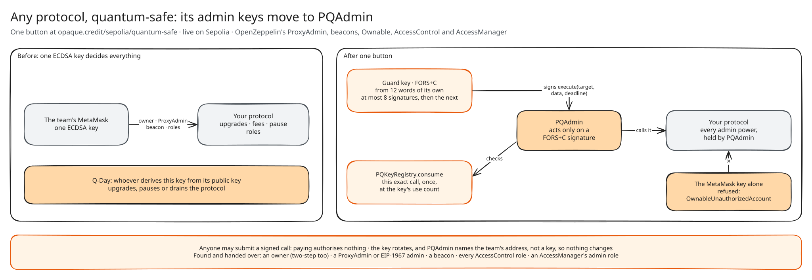
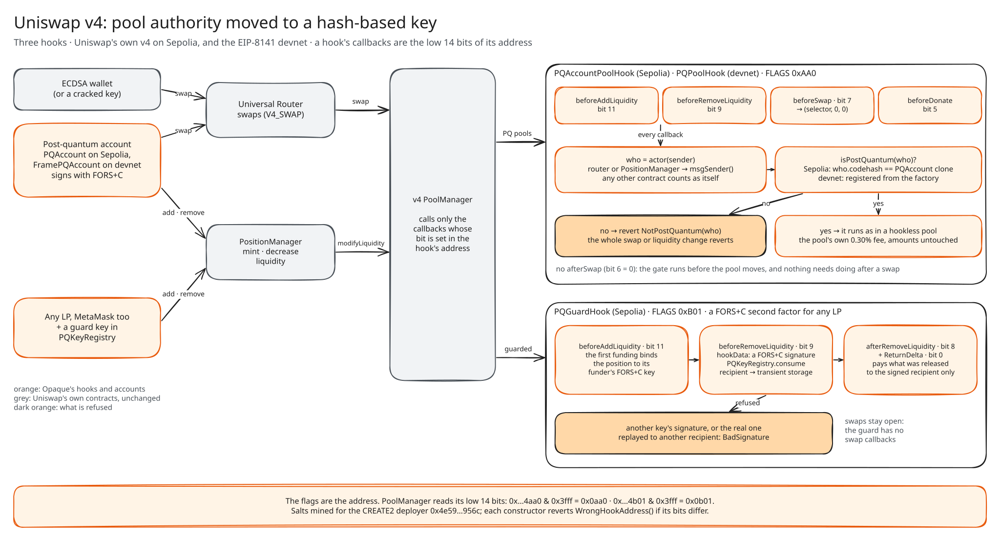
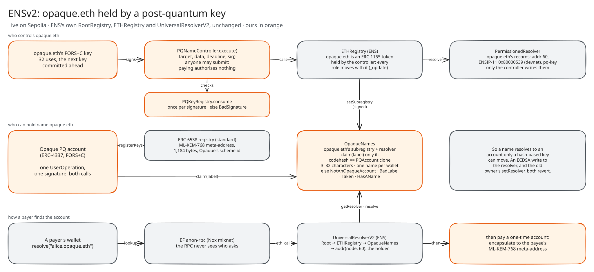
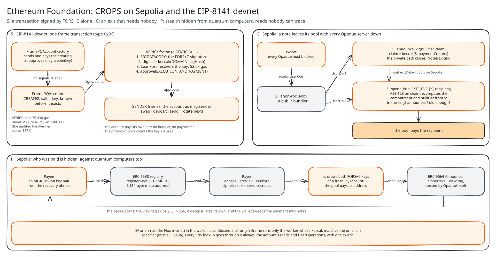

# Opaque · ETHGlobal Mumbai

### The post-quantum security layer for Ethereum. Accounts, payments, names, liquidity and any protocol's admin keys, moved to hash-based keys. Live today.

[**Open the wallet**](https://www.opaque.credit/testnet/devnet) · [The project page](https://www.opaque.credit/ethglobal-mumbai) · [Sepolia wallet](https://www.opaque.credit/sepolia/app) · [Keep MetaMask](https://www.opaque.credit/sepolia/vault) · [Make any protocol quantum-safe](https://www.opaque.credit/sepolia/quantum-safe) · [Opaque beside MetaMask](https://www.opaque.credit/connect-opaque) · [Main README](../../README.md)

## Contents

1. [In one line, and in one paragraph](#in-one-line-and-in-one-paragraph)
2. [The problem](#the-problem)
3. [What we built](#what-we-built)
4. [Five minutes for a judge](#five-minutes-for-a-judge)
5. [Prize tracks](#prize-tracks)
6. [How it's made](#how-its-made)
7. [What existed before the event, and what we built at it](#what-existed-before-the-event-and-what-we-built-at-it)
8. [Proof](#proof)
9. [Honest about it](#honest-about-it)
10. [In this folder](#in-this-folder)

## In one line, and in one paragraph

**Opaque is the post-quantum security layer for Ethereum: everything ECDSA guards today moves to hash-based keys, and payments become private. Live on Sepolia and the EIP-8141 devnet.**

Ethereum's accounts, names, LP positions and privacy all rest on elliptic curves, and a quantum computer breaks every one of them, including privacy already on chain. Opaque moves all of it to cryptography a quantum computer doesn't break:
- **Signatures:** FORS+C, a hash-based scheme, for the account, the attester, the ENS controller and the LP guard.
- **Payments:** a ZKBoo ring proof over AES-128, carried by an ML-KEM onion mesh.
- **Receiving:** ML-KEM-768 stealth addresses on the standard ERC-5564 and ERC-6538 contracts.

It works with what Ethereum already has:
- Uniswap's own v4, through three hooks;
- ENSv2 unchanged, through a controller that holds opaque.eth;
- ERC-4337 through a public bundler;
- EF's anon-rpc for reads;
- EIP-8141, where the transaction itself is signed by FORS+C alone, in 76,430 gas.

Every note can leave its pool with all of Opaque's servers switched off.

**It's more than a wallet.** The Opaque wallet is one way in, but most of the layer works for people who never switch:
- `PQAdmin` makes any protocol's admin keys quantum-safe with one button;
- `PQGuardHook` protects any Uniswap LP, MetaMask's included;
- the Q-Day vault protects what's in any MetaMask wallet;
- `PQNameController` holds any ENSv2 name.

## The problem

- **Ethereum's keys don't outlive a quantum computer.**
  - Every account that has signed has published its ECDSA public key, and from a public key Shor's algorithm recovers the private key.
  - When that's practical, every exposed wallet, LP position and ENS name can be taken.
  - The protocol's own answer is a last-resort emergency fork. Nobody should be waiting for it.
- **Today's privacy expires.**
  - Chain data is permanent. A stealth payment hidden with secp256k1 Diffie-Hellman (ERC-5564's scheme 1) can be opened the day secp256k1 falls, so every payment ever announced becomes linkable at once.
  - A SNARK pool whose proofs rest on pairings over BN254 can, on that day, be withdrawn from with a forged proof.
  - Privacy that must still hold in ten years has to be post-quantum on the day the payment is made.
- **Privacy that depends on one operator is a promise.** If a wallet's withdrawals need its operator, the operator can switch them off.
- **Every read leaks.** An RPC provider sees your IP and every address you ask about, whatever the pool hides.

## What we built

### For anyone, with the keys and contracts they already have

| | |
|---|---|
| **Make any protocol quantum-safe** | One button hands a contract's admin keys (an Ownable owner, an OpenZeppelin ProxyAdmin, an AccessControl admin role) to `PQAdmin`, which acts only on a FORS+C signature. Upgrades, pauses and fee changes then need the hash-based key. |
| **Uniswap v4 liquidity a quantum computer can't take** | `PQGuardHook`: a FORS+C second factor for *any* LP, MetaMask's included, which pays only the recipient it signed. Plus pools only post-quantum accounts can trade in, on Uniswap's own Sepolia v4 and on the devnet. |
| **Keep MetaMask** | The Q-Day vault: MetaMask puts money in, and only a FORS+C signature takes it out. |
| **ENSv2 names a quantum computer can't take** | opaque.eth is owned by `PQNameController`, which acts only on a FORS+C signature. `name.opaque.eth` can be claimed only by post-quantum accounts, in the same signature that turns on stealth payments, and it labels the account in the wallet. |

### In Opaque's own post-quantum accounts

| | |
|---|---|
| **Post-quantum accounts** | FORS+C keys from one recovery phrase. The phrase stays in your browser, sealed under your wallet password once you set one. Few-time keys hand over to a next key they committed to in advance. ERC-4337 on Sepolia; EIP-8141 frame transactions on the devnet. |
| **Private payments, USDC and ETH** | Pools of fixed-size notes. A ring proof shows a note is one of 8 without saying which, carried by three relays, and the pool pays. ETH goes in as WETH notes, wrapped and deposited in one operation. |
| **Post-quantum stealth addresses** | An ML-KEM-768 meta-address in ERC-6538's registry, ciphertexts on ERC-5564's Announcer. Every payment lands at a fresh FORS+C account only the payee can find, and the wallet sweeps it into their notes. |
| **Opaque beside MetaMask in any dapp** | An EIP-6963 provider in the extension. Every transaction a dapp asks for is approved in Opaque and signed by the post-quantum account. |
| **Reads nobody can trace** | EF's anon-rpc (the Nox mixnet): for ENS always, and for the whole account with one switch. |
| **Leave without us** | Exitable pools: announce, wait, reveal, and AES-128 on chain recomputes the note. It works with every Opaque server down, through anon-rpc and a public bundler. |
| **Transactions signed by FORS+C alone** | On EIP-8141, the VERIFY frame checks FORS+C in 76,430 gas, inside the public mempool's 100k budget. The account pays for itself, with no bundler and no paymaster. Accounts are created with no signature at all. |
| **Activity** | Private payments, names, swaps, deposits, public sends and make-private, kept in the browser. A name claimed earlier is found again from the chain, through anon-rpc. |

## Five minutes for a judge

| Minute | Do this | What to look for |
|---|---|---|
| 1 | Open [/sepolia/app](https://www.opaque.credit/sepolia/app), make a wallet, tap **Get test funds**. | The account's address exists before the account does. Its first UserOperation deploys it, signed by FORS+C. |
| 2 | **Send** 5 tUSDC privately to any address. | On Etherscan, the transaction that pays is sent by Opaque's settler, from the pool. Your account sent nothing. |
| 3 | **Names**: claim `yourname.opaque.eth`. | One signature claims the name and publishes the ML-KEM-768 meta-address. Paying the name pays a one-time account. |
| 4 | Open [/testnet/devnet](https://www.opaque.credit/testnet/devnet) and send. | On the devnet explorer: a type 0x06 frame transaction, VERIFY first, signed by FORS+C alone. |
| 5 | In **Privacy**, turn on **Opaque Unseen** (anon-rpc), or block opaque.credit's hosts and use **Leave without Opaque**. | The wallet keeps working, and the note still leaves its pool. |

## Prize tracks

| Track | What it gets | Page |
|---|---|---|
| **Uniswap**: v4 hooks | Three hooks that move pool authority to a hash-based key, live at Uniswap's own Sepolia v4 and on the devnet | [uniswap.md](../../partner-docs/ethglobal-mumbai/uniswap.md) |
| **ENS**: ENSv2 | A real ENSv2 name held by a post-quantum key. Subnames only for post-quantum accounts, with post-quantum stealth payments to them. | [ens.md](../../partner-docs/ethglobal-mumbai/ens.md) |
| **Ethereum Foundation**: CROPS, anon-rpc, EIP-8141 | An exit that needs nobody, ML-KEM stealth, anon-rpc reads, and FORS+C-only frame transactions | [ethereum-foundation.md](../../partner-docs/ethglobal-mumbai/ethereum-foundation.md) |

### Uniswap

- **The claim:** a liquidity position can sit for years, and today one ECDSA key decides where it goes. A v4 hook decides who may add, remove, swap and donate. So a hook can make a pool's authority post-quantum **now**, with no change to Ethereum or to Uniswap's core.
- **`PQAccountPoolHook`** (Sepolia) and **`PQPoolHook`** (devnet), flags `0xAA0`:
  - `beforeAddLiquidity`, `beforeRemoveLiquidity`, `beforeSwap` and `beforeDonate` each resolve the real caller with `actor(sender)` (`msgSender()` on Uniswap's PositionManager and Universal Router);
  - they revert with `NotPostQuantum(who)` unless that caller is a post-quantum account;
  - `beforeSwap` returns `(selector, 0, 0)`, so a passing swap is exactly a hookless one;
  - there's no `afterSwap`, because the gate belongs before the pool moves.
- **`PQGuardHook`**, flags `0xB01`, protects any LP:
  - the first funding binds the position to the funder's FORS+C key;
  - a removal carries a signature over the recipient and a deadline, consumed once in `PQKeyRegistry`;
  - `afterRemoveLiquidity`, with its return delta, pays only that recipient.
- **On chain:**
  - an ECDSA swap through Uniswap's own Universal Router reverts with `NotPostQuantum`;
  - the account's swap bought exactly the quote;
  - a cracked key and a replayed signature are both refused with `BadSignature`.

### ENS

- **The claim:** an ENS name is an identity people pay. If its owner's key can be cracked, so can every payment to it. ENSv2 moves every role over a name with its ERC-1155 token, so giving the token to a contract whose only authority is a FORS+C key makes the name post-quantum, with **no change to ENS**.
- **`PQNameController`** holds opaque.eth. It calls out only on a FORS+C signature over the action, chain, controller, deadline, target and calldata hash, consumed once in `PQKeyRegistry`.
- **`OpaqueNames`** is opaque.eth's subregistry and resolver:
  - `name.opaque.eth` can be claimed only by a post-quantum account, by code hash, with 3–32 characters and one name per wallet;
  - it resolves `addr`, `addr(coin)` and ENSIP-10 `resolve` through UniversalResolverV2, unchanged;
  - it serves ENSIP-11 coin `0x80000539` for the devnet.
- **The claim turns on stealth in the same signature.** Lookups go through anon-rpc.

### Ethereum Foundation

- **S, security: EIP-8141 with FORS+C alone.**
  - `FramePQAccount.verify` runs `SIGDATACOPY`, then `LeanFors`, then `approve(EXECUTION_AND_PAYMENT)`, in 76,430 gas against `MAX_VERIFY_GAS` = 100,000.
  - The audited verifier needs 167k; `LeanFors` is the same function with its loop in assembly, at 53.6k, held to the original on 1,024 fuzzed tamperings.
  - The protocol nonce counts the key's uses, because VERIFY can't write storage.
  - The factory creates accounts with no signature at all.
- **C, censorship resistance: the exit.**
  - `announceExit(nullifier, keccak(S, paymentContext))` binds the payout and closes the private path.
  - After `exitDelay`, `spend` reveals `S`, and `AES128.sol` recomputes the commitment and nullifier on chain.
  - The wallet does it through anon-rpc and a public bundler, with every Opaque host blocked.
- **P, privacy:**
  - the ring proof and the three-hop mesh hide the payer;
  - ML-KEM-768 stealth hides the payee, now and later;
  - anon-rpc hides the reader.
- **O, open source:** Apache-2.0, all of it in this repository.

## How it's made

### Signatures: FORS+C, verified on chain

- **The scheme.** FORS+C is a few-time, hash-based signature ([`packages/pq-wallet`](../../packages/pq-wallet/README.md)), and its security rests on keccak alone.
  - A key is `k` Merkle trees of height `a`. The message digest picks one leaf in each tree, and the signature reveals those leaves and their paths.
  - FORS is the few-time layer inside SLH-DSA (FIPS 205).
- **Sizes.** At k=32, a=8 a signature is 9,251 bytes and a key signs 32 times. On the devnet, k=13, a=13, a key signs 8 times.
- **Every use is counted twice.**
  - The browser commits a reservation before a signature exists, and a crash burns that index.
  - `PQKeyRegistry.consume` counts each signature on chain and refuses at the limit.
- **Rotation.** Each key commits to its successor in advance, and the wallet rotates on its own.
- **The digest** is length-prefixed keccak over a domain, the chain, the account, the scheme, the use count and the payload's hash. Every action has its own domain, so a signature for one is never valid as another.
- **On chain,** the audited `ForsVerifier` checks it in 260k gas (k=32, a=8). For EIP-8141 we wrote [`LeanFors`](../../contracts/src/ethereum/frame/LeanFors.sol): 53.6k at k=13, a=13.

### Accounts

- **Sepolia:** `PQAccount`, an ERC-4337 v0.7 account and an EIP-1167 clone, whose only authority is its key in `PQKeyRegistry`.
  - No owner, admin or upgrade path can change the key; only a FORS+C signature under the current key can.
  - Pimlico's public bundler carries the UserOperations and authorizes nothing.
  - Many calls go in one `executeBatch`: wrap, approve and deposit, or claim and publish a stealth key.
- **Devnet:** [`FramePQAccount`](../../contracts/frame/FramePQAccount.sol), encoded with `@forshtat/hegota-support`.
  - Its VERIFY frame copies the signature with `SIGDATACOPY`, signs `keccak(DOMAIN, sigHash)`, recovers the key with `LeanFors` and approves execution and payment.
  - `rotate(next)` runs from its own SENDER frame.
  - `FramePQAccountFactory` is the sender of the creating transaction and pays for it, approving only one `create(key)` frame. The address is CREATE2 on the key, so it's known first.

### Private payments

- **Notes.** A note is a 16-byte secret `S`. The pool stores `AES-128(S, noteBlock)`, and spending reveals `AES-128(S, nullBlock)`. Both blocks are keccak-derived and bound to the pool.
- **The ring.** It's read from the pool's own `Deposited` events, with no indexer: 8 members, sorted. Every pool was seeded with 8 deposits whose secrets nobody keeps.
- **The proof** is ZKBoo, MPC-in-the-head over an AES-128 circuit, built in a Web Worker ([`backend/zk`](../../backend/zk/README.md)).
  - It uses 219 repetitions for 2⁻¹²⁸ soundness, is 1.08 MiB, and takes 2.2 s to prove.
  - Its Fiat-Shamir challenge binds the verifier, pool, chain, denomination, recipient, ring and nullifier.
  - The note secret never leaves the page.
- **Transport** ([`backend/mesh`](../../backend/mesh/protocol.md)).
  - About 35 chunks of 32,640 bytes go through three hops chosen from six relays, wrapped for each hop with ML-KEM-768, HKDF-SHA-256 and AES-256-GCM.
  - Every layer has its own random id, so the relays share no identifier. Payloads are padded, so a payment and a query look the same at every hop.
- **Settlement.**
  - The attester verifies the proof (2.0 s) and signs with its own FORS+C key.
  - The settler sends `pool.spend`.
  - The pool checks the attestation through `PQKeyRegistry`, that every ring member is a real deposit, and that the nullifier is fresh. Then it pays one denomination to the bound recipient.
- **ETH:** WETH pools of 0.0005, 0.001 and 0.005 ETH. "Make private" splits an amount into notes and does WETH `deposit{value}`, `approve` and every pool deposit in one operation.

### Stealth payments

- **Scheme id:** `keccak256("opaque/v1/stealth/ml-kem-768/fors-c")`, on the standard ERC-6538 registry and ERC-5564 Announcer.
- **Paying:**
  - the payer encapsulates to the 1,184-byte meta-address, which gives a 1,088-byte ciphertext and a shared secret;
  - the shared secret draws both FORS+C keys of a fresh `PQAccount`, whose address the payer computes through the factory;
  - the pool pays that address.
- **Finding it:**
  - a 1-byte view tag skips 255 in 256 announcements;
  - the payee decapsulates its own and sweeps the payment into its notes;
  - the one-time account's first UserOperation deploys it and deposits.

### ENSv2

- **Holding the name.** opaque.eth was registered, then transferred to `PQNameController`. Every role moved with the token (`PermissionedRegistry._update`).
- **Records and subregistry.** The controller set the resolver, the records and the subregistry, each by a FORS+C signature anyone could submit.
- **Subnames.** [`OpaqueNames`](../../contracts/src/ethereum/ens/OpaqueNames.sol) is the subregistry and resolver. Claims are checked against the `PQAccount` clone's code hash, and UniversalResolverV2 resolves through it unchanged.

### Uniswap v4

- **Salts.** The hooks' salts are mined for their permission bits, and each constructor reverts if its address has the wrong ones.
- **Callers.** The real caller is read through Uniswap's own PositionManager and Universal Router (`msgSender()`). Any other router counts as itself.
- **The guard** keeps the signed recipient in transient storage and pays only it, from `afterRemoveLiquidity`.
- **Quotes.** The wallet quotes from PoolManager storage (`extsload`) with v4's swap-step math. The quote matches the router to the unit.

### The exit

- **The contracts.** [`ExitableRingVerifier`](../../contracts/src/opaque/pool/ExitableRingVerifier.sol) wraps the audited `AttestedRingVerifier` unchanged, and adds `announceExit` and an `EXIT_TAG` spend.
- **The check on chain.** [`AES128.sol`](../../contracts/src/opaque/lib/AES128.sol) recomputes the note from the revealed secret, and is checked byte for byte against the wallet's derivation.
- **Racing.** An announced nullifier can't be spent privately (`NoteIsExiting`). Racing the reveal would need an announcement `exitDelay` old for a secret the racer hadn't seen.

### anon-rpc

- **Running it safely.** The wallet reads the Nox network's worker hash from its specifier on Sepolia (`0x3513…7A9A`), and runs only bytes that match, in a Web Worker inside a sandboxed, null-origin iframe.
- **The account's traffic.** With the switch on, the account's reads and UserOperations are answered in the browser by the same code Opaque's egress runs, pointed at a public RPC and Pimlico's bundler, through the mixnet.

### Connect with Opaque and the Q-Day vault

- **The provider.**
  - [`opaque-eth-provider.ts`](../../frontend/src/lib/opaque-eth-provider.ts) is an EIP-1193 provider announced with EIP-6963 (`rdns: credit.opaque`), and it never sets `window.ethereum`.
  - Wallet methods open an approval window that checks both ends' origins and shows each call.
  - Approved calls are sent as one UserOperation the FORS+C key signs. A rejection returns 4001.
- **The vault.** [`PQVault`](../../contracts/src/ethereum/vault/PQVault.sol) takes deposits from any address. Withdrawals need a FORS+C signature over the token, amount, recipient and deadline, and anyone may submit one.

### Hacky bits worth knowing

- **No `eth_call` on the devnet.** ethrex refuses `eth_call` from a contract address and takes no state overrides, so devnet quotes come from storage.
- **Dropped transactions.** The alt mempool sometimes drops a transaction it accepted. FORS signing is deterministic, so the wallet re-broadcasts the *same bytes* to the gateway and the miner until mined, and no key signs twice for one nonce.
- **Stealth key custody.** Hash-based keys can't be tweaked like elliptic-curve keys, so a stealth payer briefly holds the one-time account's keys. The wallet sweeps as soon as the payment lands.
- **Gas price.** Pimlico prices Sepolia gas at about 1.15 gwei while the chain's own price is near zero, so "Make private" keeps 0.004 ETH back for gas.
- **Faucets.** The devnet's faucet ran dry, so Opaque has its own: a contract that pays its own frame transaction, so a page asks with no key.

### Stack

- **Contracts:** Solidity with Foundry; solc 0.8.28 for the frame contracts.
- **Wallet:** TypeScript and Vite, as the web page, the Chrome MV3 extension and a PWA. Cryptography comes from `@noble/hashes` and `@noble/post-quantum`.
- **Backend:** relays, egress, attester and settler run on Railway, and the site on Vercel.
- **Tests:** Playwright runs the real pages against Sepolia and the devnet.
- **Partner technology used:**
  - Uniswap v4: PoolManager, PositionManager, Universal Router, StateView, Permit2;
  - ENSv2: RootRegistry, ETHRegistry, PermissionedResolver, UniversalResolverV2;
  - EF: anon-rpc (Nox) and the EIP-8141 devnet;
  - ERC-4337 (Pimlico), ERC-5564, ERC-6538, EIP-6963.

## What existed before the event, and what we built at it

**Before (Opaque on Arc, from 16 October 2026):**
- the FORS+C signer;
- `PQKeyRegistry`, `PQAccount` and the audited `ForsVerifier`;
- `PrivatePool` and the audited `AttestedRingVerifier`;
- the ZKBoo ring proof;
- the ML-KEM relay mesh;
- the wallet password lock;
- the Arc and XRPL wallets.

**At ETHGlobal Mumbai (5–6 November, from commit [`7d15d96`](https://github.com/Opaque-wallet/opaque-wallet/commit/7d15d96)):** everything on Ethereum.

| Area | Built at the event |
|---|---|
| **Networks** | Sepolia and the EIP-8141 devnet, deployed |
| **EIP-8141** | `LeanFors`, `FramePQAccount` and its factory, the devnet privacy stack and the devnet wallet |
| **The exit** | `ExitableRingVerifier`, `AES128.sol`, and leaving without Opaque |
| **Privacy** | ML-KEM stealth, anon-rpc, WETH notes |
| **ENS and Uniswap** | `PQNameController`, `OpaqueNames` and the three v4 hooks |
| **MetaMask users** | `PQVault`, and Connect with Opaque |
| **Any protocol** | `PQAdmin` and its one-button page |

The audited contracts were deployed unchanged; new behaviour lives in new contracts beside them.

## Proof

| Check | Result |
|---|---|
| `cd contracts && forge test` | 154 passed |
| `cd backend && npm test` | 396 passed |
| `scripts/e2e-sepolia.ts` | 33 checks against the live site and Sepolia: a private payment, a v4 swap, a name claimed and paid at a one-time address, the sweep, anon-rpc, and a note leaving its pool with every Opaque server blocked |
| `scripts/e2e-sepolia-eth.ts` | 0.0015 ETH made private in one operation and sent privately. The payee holds exactly 0.0015 WETH, with no transfer from the wallet's address. |
| `scripts/e2e-eth-connect.ts` | 19 checks: Opaque found by EIP-6963, connected, a mined transaction, a rejection returned as 4001 |
| `scripts/e2e-vault.ts` | MetaMask's flow: register, deposit, the thief refused, a signed withdrawal |
| `scripts/e2e-admin.ts` | Any protocol: two ECDSA admin keys handed to the `PQAdmin` with one button, the cracked key refused, a signed fee change and upgrade on chain |
| `scripts/e2e-devnet-private.ts` | A private payment on the devnet, every signature FORS+C |
| `scripts/e2e-devnet-page.ts` | The devnet account's life: created with no signature, a FORS+C-only send, a v4 swap |

Deployment addresses are in each partner page, and in [`deployments/eth-sepolia.json`](../../deployments/eth-sepolia.json) and [`deployments/eth-devnet.json`](../../deployments/eth-devnet.json).

## Honest about it

- **One operator, for now.** Private payments use our attester and relays. **Before mainnet, the relays will be run by multiple independent operators.** The exit already works without any of it.
- **The attester is trusted for soundness.**
  - The proof is too big for the chain, so a dishonest attester could approve a spend no proof supports.
  - It can't learn who paid, and every proof can be checked again by anyone.
  - It can't stop a note leaving.
- **The anonymity set is the ring:** 8 notes of one size. Amounts are public, and a payment's timing isn't hidden.
- **A read through anon-rpc takes about a second.**
- **Testnet only.** The new contracts are tested, not audited. The audited contracts deploy unchanged.

## In this folder

- [`PLAN.md`](PLAN.md): the build, task by task, with every address checked on chain.
- [`VIDEO.md`](VIDEO.md): the demo video's script, timed to three minutes.
- [`anon-rpc-adopter.md`](anon-rpc-adopter.md): Opaque's entry for anon-rpc's adopters list.
- [`erc-exitable-pools.md`](erc-exitable-pools.md): a draft ERC for exitable privacy pools.
- [`opaque-ethereum.excalidraw`](opaque-ethereum.excalidraw), [`opaque-privacy-layer.excalidraw`](opaque-privacy-layer.excalidraw): the first sketches. The finished diagrams are in [`diagrams/`](../../diagrams/): `ethereum`, `uniswap`, `ens` and `ethereum-foundation`.

Apache-2.0 · [Main README](../../README.md)
