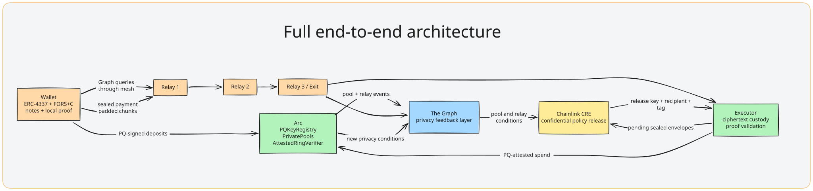

# Opaque partner evidence

### Each integration is load-bearing, and each page shows the proof.

## ETHGlobal Mumbai: Opaque on Ethereum

In [`ethglobal-mumbai/`](ethglobal-mumbai/README.md), with an index of where each partner's code is.

| Partner | The role it plays in Opaque | Deployed, and what it shows |
|---|---|---|
| **[Uniswap v4](ethglobal-mumbai/uniswap.md)** | Hooks that put pool authority behind a hash-based key: a FORS+C second factor for any LP (MetaMask included), and pools only post-quantum accounts can trade in. | Three hooks live at Uniswap's own Sepolia v4 and on the EIP-8141 devnet, on-chain refusals of a cracked ECDSA key, 15 forge tests, the wallet's Swap tab. |
| **[ENS](ethglobal-mumbai/ens.md)** | opaque.eth on ENSv2 owned by a contract that acts only on a FORS+C signature; name.opaque.eth claimable only by post-quantum accounts, with post-quantum stealth payments to the name. | Controller and subregistry on Sepolia, the FORS-signed adoption and records, UniversalResolverV2 resolution, 13 forge tests, the e2e that claims, pays and sweeps. |
| **[Ethereum Foundation](ethglobal-mumbai/ethereum-foundation.md)** | CROPS made real: an exit from every pool with every Opaque server down, ML-KEM-768 stealth payments on ERC-5564/6538, reads through anon-rpc, and FORS+C-only EIP-8141 transactions that fit the public mempool's 100k validation budget. | The exit e2e with Opaque blocked, 76,430-gas VERIFY frames on the devnet, LeanFors held to the audited verifier, drafts of an ERC and an anon-rpc adopter entry. |

## Earlier: Opaque on Arc

| Partner | The role it plays in Opaque | Deployed, and what it shows |
|---|---|---|
| **[Arc + Circle](arc.md)** | Settlement chain, USDC money and gas, ERC-4337 accounts, denomination pools, CCTP V2 onboarding. | Live Arc addresses, USDC flow, CCTP transaction, deployment and source map. |
| **[Chainlink CRE](chainlink.md)** | Confidential authority for sealed privacy thresholds, deadlines, and payment-release decisions. | Active AWS Nitro workflow, Vault DON secrets, release flow, deployment evidence. |
| **[The Graph](the-graph.md)** | Privacy coordination layer: public conditions powering local decoys, Markov paths, and CRE readiness. | Live Arc subgraph, schema, mappings, score formula, trust boundaries. |

Each page answers the same four questions:

~~~text
What did Opaque build with this partner?
Why is it load-bearing rather than decorative?
Where is it deployed, and what does it show on chain?
What privacy boundary does the integration preserve?
~~~

[Back to the main README](../README.md) · [Module interfaces](../docs/interfaces.md) · Deployment maps: [Sepolia](../deployments/eth-sepolia.json) · [EIP-8141 devnet](../deployments/eth-devnet.json) · [Arc mainnet](../deployments/arc-mainnet.json) · [Arc testnet](../deployments/arc-testnet.json)
