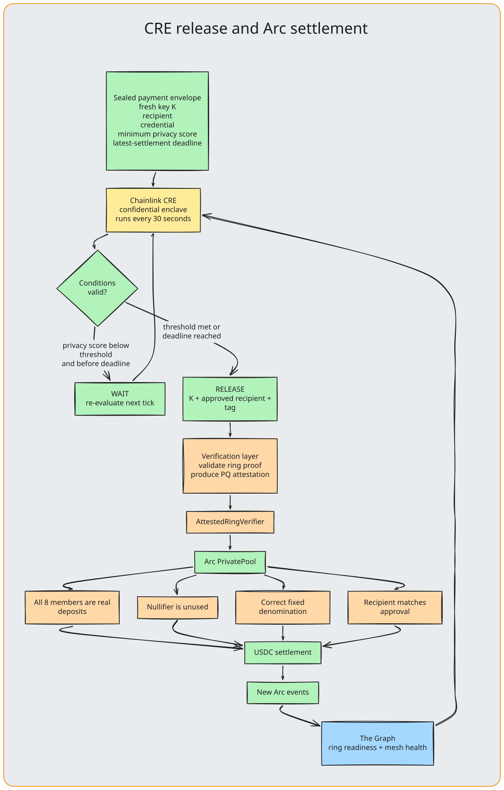

# Opaque × Arc

### Programmable private USDC settlement, built natively on Arc.

**Arc is Opaque’s settlement layer: the place where private notes become a real USDC payment under enforceable conditions.**

> **Track:** Best DeFi/Onchain Finance Application, Arc

## Why Opaque is native to Arc

Opaque is not a wallet deployed onto Arc. It is a private USDC settlement flow designed around what Arc makes possible:

| Arc primitive | What Opaque does with it | Why it is load-bearing |
|---|---|---|
| **USDC as money and gas** | The same asset funds the account, creates notes, pays for UserOperations, and reaches the recipient. | A post-quantum account needs no ECDSA wallet, native token, or separate gas balance. |
| **Programmable settlement** | A pool releases fixed-denomination USDC only after proof, nullifier, recipient, and confidential-policy checks pass. | Privacy is an enforceable payment condition, not an off-chain promise. |
| **ERC-4337** | FORS+C authorizes a smart account through PQKeyRegistry and PQValidator. | The account is controlled by a hash-based key rather than a conventional wallet signer. |
| **CCTP V2** | USDC moves from Sepolia to the same Arc account that creates private notes. | A user can enter the private payment rail with native Circle liquidity. |

## One conditional private USDC payment

~~~text
1. Fund a PQ ERC-4337 account with USDC on Arc or through CCTP V2.
2. Deposit USDC into fixed-denomination pools; each deposit creates a private note.
3. Locally form an 8-member same-denomination ring and seal the payment terms.
4. Chainlink CRE checks the sealed privacy threshold, deadline, and credential.
5. The attester verifies the proof and provides a post-quantum authorization.
6. Arc enforces real ring members, one unused nullifier, denomination, and recipient.
7. The pool transfers USDC to the recipient.
~~~

The deposit is attributable by design. The later private spend does **not** name which deposited note paid.

## The programmable-money mechanics

| Mechanic | Arc-enforced or Arc-observed behaviour |
|---|---|
| **Fixed denominations** | A 20 USDC note only hides among other 20 USDC notes. Amount privacy comes from interchangeable buckets, not an opaque balance. |
| **One-time spending** | The pool marks a fresh nullifier before moving USDC, preventing a note from being released twice. |
| **Conditional release** | CRE may release as soon as public privacy conditions meet the payer’s sealed threshold; otherwise it settles at the payer’s latest-settlement deadline. |
| **Recipient binding** | The final recipient must match the released payment terms before settlement proceeds. |
| **PQ key lifecycle** | The registry tracks FORS+C use and accepts rotation only under the current post-quantum authority. |
| **Relay health telemetry** | RelayDirectory emits health and identity events that The Graph turns into privacy coordination signals. |

## Settlement contracts

Live on **Arc mainnet** (chain 5042) since 2026-10-14, each address checked against the chain by `backend/chain/test/deployments.test.ts`. [deployments/arc-mainnet.json](../deployments/arc-mainnet.json) is the complete source of truth. The pools are **unaudited**.

| Contract | Address | Settlement role |
|---|---|---|
| **PQKeyRegistry** | [0x33a9…2faf](https://explorer.arc.io/address/0x33a9d3e188835e8287f55a1a8cb7bd6554ed2faf) | PQ key registration, use budget, and rotation |
| **PQAccountFactory** | [0x5f8b…0206](https://explorer.arc.io/address/0x5f8bd9531a08b6c06eeb41d9f617038e38d40206) | Counterfactual ERC-4337 account deployment, staked in EntryPoint v0.7 |
| **PQAccount implementation** | [0x9a1c…b58e](https://explorer.arc.io/address/0x9a1c7294dc884954ebf4fcb2ba04f8bf814bb58e) | UserOperation execution under PQ authority |
| **PQValidator** | [0x7786…8e4b](https://explorer.arc.io/address/0x7786dfcd410c712f5b72dd6b0e7c8c74aaf88e4b) | FORS+C validation for EntryPoint v0.7 |
| **RelayDirectory** | [0x342c…d281](https://explorer.arc.io/address/0x342ced088848740b7b3885c70c5ae6368f79d281) | Relay announcements and health reporting |
| **EntryPoint v0.7** | 0x0000000071727de22e5e9d8baf0edac6f37da032 | ERC-4337 execution entrypoint |

| RING_8 pool | Address | | RING_8 pool | Address |
|---|---|---|---|---|
| 1 USDC | [0xb753…21ea](https://explorer.arc.io/address/0xb753058ec7a8cf29d96288a5e5ae5c01c23221ea) | | 20 USDC | [0x6902…bbf9](https://explorer.arc.io/address/0x6902a8c0e75d12efe138ed829a2156a3225abbf9) |
| 2 USDC | [0x4cc9…64f7](https://explorer.arc.io/address/0x4cc97933541d3411ca22c4303e8fdf7fe7fe64f7) | | 50 USDC | [0x8406…b745](https://explorer.arc.io/address/0x8406e07a27c6c38f4089d5174840b9db53bbb745) |
| 5 USDC | [0xcf4f…e1ac](https://explorer.arc.io/address/0xcf4fc5093bcae2999e7059329d8df1fe4153e1ac) | | 100 USDC | [0x91c5…2bd4](https://explorer.arc.io/address/0x91c5d56b77b2e1453647d37ca6350194a4c42bd4) |
| 10 USDC | [0xe3d1…9026](https://explorer.arc.io/address/0xe3d1c899d2700559403341db5dc26577d2669026) | | | |

The same stack runs on Arc testnet for development: [deployments/arc-testnet.json](../deployments/arc-testnet.json).

## CCTP V2 entry path

On testnet, Opaque uses CCTP V2 for USDC onboarding from Ethereum Sepolia. On mainnet, users fund their account with USDC already on Arc; the same CCTP route from Ethereum mainnet is next.

~~~text
approve + depositForBurn on Sepolia, domain 0 → Arc domain 26
  → maxFee set to twice Circle’s current quote
  → poll Circle attestation until final
  → receiveMessage on Arc
  → USDC reaches the same account that deposits private notes
~~~

| Contract | Address |
|---|---|
| TokenMessengerV2, Sepolia | 0x8fe6b999dc680ccfdd5bf7eb0974218be2542daa |
| MessageTransmitterV2, Arc | 0xe737e5cebeeba77efe34d4aa090756590b1ce275 |
| USDC, Sepolia | 0x1c7d4b196cb0c7b01d743fbc6116a902379c7238 |

## Engineering evidence

| What we learned | Response in Opaque |
|---|---|
| Native USDC and ERC-20 USDC use different decimals. | All amount handling carries explicit units; native gas uses 18 decimals while pooled ERC-20 USDC uses 6. |
| Public RPC log windows and bursts are bounded. | Pool scanning pages logs in 10,000-block windows and falls back across Circle, QuickNode, and Blockdaemon RPCs. |
| A public RPC is not a bundler. | UserOperations use Pimlico’s keyless Arc endpoint for EntryPoint v0.7, on mainnet (5042) and testnet alike. |
| Small operations must stay economically viable. | On mainnet, the whole PQ wallet layer deployed for 0.067 USDC of gas (plus the factory's 1 USDC EntryPoint stake), and all seven pools with the attester's registration for 0.22 USDC. A relay health report costs about 0.0018 USDC. |

## Scope choices

- **CCTP V2, not Gateway:** CCTP provides the working Sepolia-to-Arc entry route. Gateway remains a future unified-liquidity integration.
- **Opaque PQ account, not Circle Wallets:** Circle Wallets use conventional elliptic-curve signers; Opaque needs the account authority itself to be post-quantum.
- **One stablecoin, not FX:** A single USDC asset and fixed buckets protect amount anonymity. StableFX and App Kits do not improve this V1 flow.

## Source evidence

| File | What it proves |
|---|---|
| [PrivatePool.sol](../contracts/src/opaque/pool/PrivatePool.sol) | USDC note custody and fixed-denomination pool rules |
| [AttestedRingVerifier.sol](../contracts/src/opaque/pool/AttestedRingVerifier.sol) | Post-quantum attestation gate for an eligible ring spend |
| [PQKeyRegistry.sol](../contracts/src/opaque/wallet/PQKeyRegistry.sol) | PQ key lifecycle and bounded authorization |
| [PQAccount.sol](../contracts/src/opaque/wallet/PQAccount.sol) | ERC-4337 smart account under PQ authority |
| [pq-wallet-chain.ts](../backend/chain/pq-wallet-chain.ts) | Account deployment and UserOperations on Arc |
| [pool.ts](../backend/chain/pool.ts) | Pool interaction and RPC fallback |
| [bridge-sepolia.ts](../backend/chain/bridge-sepolia.ts) | CCTP V2 bridging flow |

## Product feedback for Arc + Circle

**What worked well**

- Arc mainnet and testnet both expose EntryPoints v0.6, v0.7 and v0.8, so Opaque needed no account-abstraction infrastructure deployment on either
- USDC gas removes an onboarding asset: the account is funded and pays with the same asset it sends.
- CCTP V2 was smooth and helpful

**What would make this easier**

- Publish public RPC log-range and burst limits
- Document a recommended ERC-4337 UserOperation bundler for Arc testnet alongside the public RPC

## Next on Arc

1. Audit the pool, verifier and account contracts now live on mainnet, and move from one attester to several independent ones.
2. Add CCTP V2 entry from Ethereum mainnet, then Gateway funding, so a note can be created from a USDC balance on any supported chain.
3. Let recipients use Gateway to receive USDC on their preferred chain after private Arc settlement.

> **Why Arc:** private payments need a stable unit, cheap programmable settlement, and gas an account can pay without a second token. USDC on Arc supplies all three.
