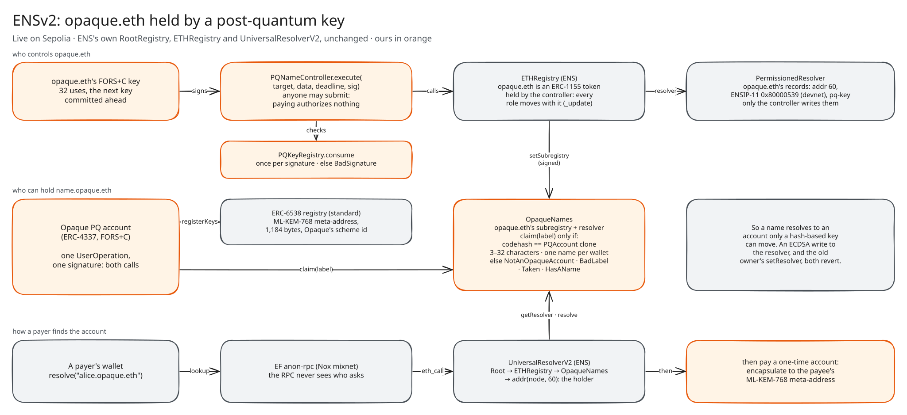
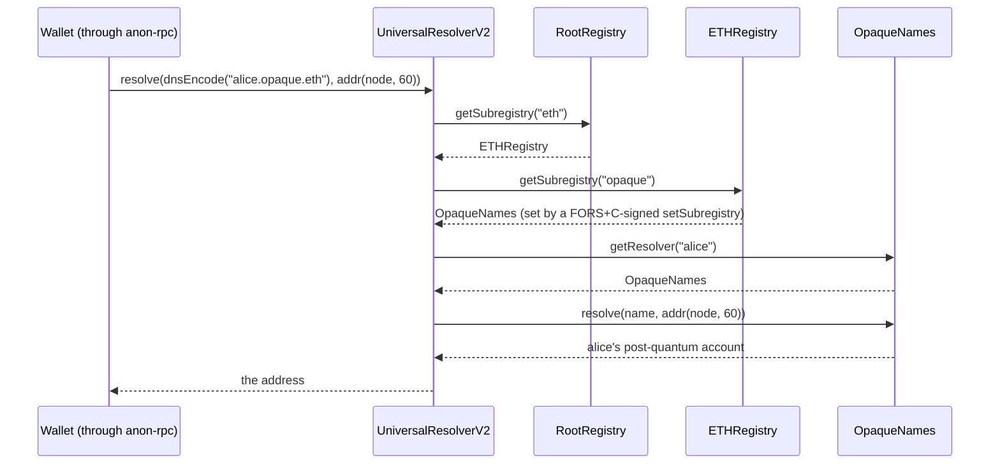

<div align="center">

# ENSv2: names held by a post-quantum key

### opaque.eth is owned by a contract that acts only on a FORS+C signature, and every name.opaque.eth is held by a post-quantum account.

[](https://sepolia.etherscan.io/address/0x4d4df91933bb30640908f5cd4a42e2cac546c131)
[](../../contracts/src/ethereum/ens/)
[](../../contracts/test/)

</div>



## Contents

1. [Why this matters](#why-this-matters)
2. [Why it works without changing ENS](#why-it-works-without-changing-ens)
3. [`PQNameController`: opaque.eth, owned by FORS+C](#pqnamecontroller-opaqueeth-owned-by-forsc)
4. [How opaque.eth was handed to the key, step by step](#how-opaqueeth-was-handed-to-the-key-step-by-step)
5. [`OpaqueNames`: name.opaque.eth for post-quantum accounts](#opaquenames-nameopaqueeth-for-post-quantum-accounts)
6. [How a name resolves](#how-a-name-resolves)
7. [In the wallet](#in-the-wallet)
8. [Errors and events](#errors-and-events)
9. [Deployment addresses](#deployment-addresses)
10. [Try it and test it](#try-it-and-test-it)
11. [Where the code is](#where-the-code-is)
12. [The boundary](#the-boundary)

## Why this matters

A name outlives every wallet behind it, which is the point of a name. If one ECDSA key holds that name, the name is exactly as safe as the key. And an ECDSA key that has signed has published its public key: the input a quantum computer needs. The day that key can be derived, whoever derives it can re-point the name and take every payment sent to it. The people paying won't notice anything.

## Why it works without changing ENS

- **Names are tokens.** In ENSv2, a name is an ERC-1155 token in a `PermissionedRegistry` (here, the `.eth` registry, `ETHRegistry`).
- **Roles travel with the token.** Every role over a name sits in a role bitmap held by the token's owner: set the resolver, set the subregistry, renew, transfer. When the token moves, `PermissionedRegistry._update` moves the owner's roles with it.
- **So a contract can hold every role.** Transfer the token to a contract, and that contract holds them all. That's the only lever we pull. There's no fork of ENS, no change to its contracts, and no special resolver in the root.
- **Records are separate.** A name's records live in its resolver. Ours is a `PermissionedResolver` made by ENS's own `VerifiableFactory`, with the controller as its **only** admin from its first block.

## `PQNameController`: opaque.eth, owned by FORS+C

**Construction.** The constructor calls `registry.register(pkCommitment, nextCommitment, maxUses, rotationDeadline)`. `PQKeyRegistry` binds a key to `msg.sender`, so the key belongs to the controller's own address. On Sepolia:
- a key signs at most **32** times (`maxUses`);
- its successor is committed in advance;
- it must rotate within **30 days** (`rotationDeadline`).

**`payload(target, data, deadline)`**, the bytes the key signs:

```solidity
abi.encode("opaque/v1/ens/execute", block.chainid, address(this), deadline, target, keccak256(data))
```

`PQKeyRegistry` wraps them in its user-action domain (`"opaque/v1/pq-wallet/action"`). It hashes them with the chain, this contract's address, the FORS+C parameters and the key's **use count**.

**`execute(target, data, deadline, signature)`**, the controller's only way to act:
1. if `block.timestamp > deadline`, revert `Expired(deadline)`;
2. `registry.consume(address(this), payload(target, data, deadline), signature)`. This reverts with `BadSignature()` unless the key in force signed exactly this, with `KeyExhausted()` past the key's registered uses (8 for every key handed over now), or with `KeyDisabled()`. On success it counts the use, so **each signature works once**;
3. `target.call(data)`, as the name's owner. A failed call reverts with `CallFailed(reason)`;
4. emit `Executed(target, selector, useCount)` and return the call's output.

What follows from that:
- **Anyone may submit a signed call.** The transaction's sender and gas payer authorize nothing, so a relayer, the wallet's bundler or anyone else can carry it.
- **The signature binds** the target, the exact calldata (by hash), the deadline, this controller and this chain.
- **Rotation:** the key hands over through `PQKeyRegistry.rotate`, authenticated by the key in force, which promotes the committed next key.
- **Receiving the name:** `onERC1155Received` and `onERC1155BatchReceived` accept the token. `supportsInterface` answers ERC-165 (`0x01ffc9a7`) and `IERC1155Receiver` (`0x4e2312e0`).

## How opaque.eth was handed to the key, step by step

All of it is in [`backend/ethereum/ens/ens-sepolia.ts`](../../backend/ethereum/ens/ens-sepolia.ts) (`deploy | adopt | records | names | status`):

| Step | What happens | Signed by |
|---|---|---|
| 1. `deploy` | Deploys `PQNameController` with key generation 0 in force and generation 1 committed next (32 uses then, 30-day rotation; keys handed over since are registered for 8). Then makes a `PermissionedResolver` through ENS's `VerifiableFactory.deployProxy(impl, salt, initialize([{account: controller, roles: ALL}], []))`, so the controller is its only admin. | the deployer, which only pays |
| 2. Transfer | opaque.eth's owner (registered through ENS's `ETHRegistrar`) calls `safeTransferFrom` on the ETHRegistry token to the controller. Every role moves with it. | the old owner, once |
| 3. `adopt` | `execute(ETHRegistry, setResolver(tokenId, resolver))`, tx `0x621bfed7…a3b1` | **FORS+C** |
| 4. `records` | `execute(resolver, multicall([setAddress(opaque.eth, 60, controller), setAddress(opaque.eth, 0x80000539, devnet account), setText(opaque.eth, "pq-key", commitment), setText(opaque.eth, "url", "https://opaque.credit")]))`: every record in **one** signature, tx `0x23aa1a10…1791` | **FORS+C** |
| 5. `names` | Deploys `OpaqueNames`, then `execute(ETHRegistry, setSubregistry(tokenId, OpaqueNames))` | **FORS+C** |
| 6. `status` | Checks the controller holds every role, the records, and that an ECDSA write (the deployer's `setText`) and the old owner's `setResolver` both **revert** | n/a |

`0x80000539` is ENSIP-11's coin type for the EIP-8141 devnet (`0x80000000 | 1337`). So opaque.eth points at a frame-transaction account on the devnet, and the devnet wallet pays names.

## `OpaqueNames`: name.opaque.eth for post-quantum accounts

`OpaqueNames` is opaque.eth's **subregistry** (what ENSv2's `IRegistry` walk asks next) and the **resolver** of every name in it.

**Construction.**
- `parent` is the ETHRegistry.
- `accountCodeHash` is `keccak256` of the EIP-1167 clone of Opaque's `PQAccount` implementation.
- `parentNode` is `namehash("opaque.eth")`.

**State.**
- `holderOf[labelHash]`: the account that holds a label.
- `nameOf[account]`: the label an account holds.
- `holderAt[node]`: the account at a name's node, for resolution.

**`claim(label)`.**
1. `msg.sender.codehash` must equal `accountCodeHash`, else `NotAnOpaqueAccount()`. Only an Opaque post-quantum account can claim, and its only authority is a FORS+C key.
2. The label must be 3 to 32 characters of `a–z`, `0–9` and inner hyphens, else `BadLabel()`.
3. It must be unclaimed, else `Taken()`, and the caller must hold no other name, else `HasAName()`: one name per wallet.
4. It records the claim and emits `Claimed(label, account)`.

**`release()`.** The caller gives up its name (`NoName()` if it has none) and `Released(label, account)` is emitted. The label can then be claimed again.

**As a registry** (what UniversalResolverV2 walks):
- `getSubregistry(label)` returns `0x0`: there are no deeper names.
- `getResolver(label)` returns this contract when the label is claimed, else `0x0`.
- `getParent()` returns `(ETHRegistry, "opaque")`.

**As a resolver** (ENSIP-10):
- `addr(node)` returns the holder.
- `addr(node, coinType)` returns the holder's 20 bytes for coin 60, and nothing otherwise.
- `resolve(name, data)` answers exactly those two profiles: `addr` `0x3b3b57de` and `addr(coin)` `0xf1cb7e06`. Anything else reverts with `UnsupportedResolverProfile(selector)`.
- `supportsInterface` answers ERC-165, `IExtendedResolver` (`0x9061b923`) and the two `addr` profiles.

So **a name resolves to the account that holds it, and only a post-quantum account can hold one.** A payer resolving `alice.opaque.eth` knows the money goes to an account that only a hash-based key can move.

## How a name resolves



opaque.eth itself resolves through the controller's `PermissionedResolver` in the same way, with records the controller set by signature.

## In the wallet

- **Claiming is the whole Names tab.** One UserOperation, signed by the account's FORS+C key, makes up to two calls:
  - `OpaqueNames.claim(label)`;
  - if stealth payments aren't on yet, ERC-6538's `registerKeys(schemeId, metaAddress)`, which publishes the account's ML-KEM-768 key. So payments to the name land at one-time addresses only the wallet can find.
- **The name labels the account.** Once the wallet knows its address, it reads `OpaqueNames.nameOf(address)`. The name replaces "Account 1" in the header and the account list, with the address under it.
- **Send takes ENS names.** `resolveName` calls UniversalResolverV2 with `addr(node, coin)`: coin 60 on Sepolia, and `0x80000539` on the devnet page. **Every lookup goes through EF's anon-rpc**, so no RPC learns who asked.
- **Send marks names held by a post-quantum key:**
  - a `*.opaque.eth` name, since `OpaqueNames` admits only PQ accounts;
  - a `.eth` name whose ETHRegistry token is owned by `PQNameController`.
- **Paying a name privately:** before paying, the wallet reads the payee's ERC-6538 meta-address. If it has one, the payer encapsulates to it and the pool pays a fresh one-time account. The ciphertext goes on ERC-5564's Announcer.
- **Release** gives the name back from the same tab.

## Errors and events

| Contract | Errors | Events |
|---|---|---|
| `PQNameController` | `Expired(uint256 deadline)`, `CallFailed(bytes reason)`; from `PQKeyRegistry`: `BadSignature()`, `KeyExhausted()`, `KeyDisabled()`, `NotRegistered()` | `Executed(target, selector, useCount)` |
| `OpaqueNames` | `NotAnOpaqueAccount()`, `BadLabel()`, `Taken()`, `HasAName()`, `NoName()`, `UnsupportedResolverProfile(bytes4)` | `Claimed(label, account)`, `Released(label, account)` |

## Deployment addresses

| Contract | Sepolia address |
|---|---|
| `PQNameController` (holds opaque.eth) | [`0x4d4df91933bb30640908f5cd4a42e2cac546c131`](https://sepolia.etherscan.io/address/0x4d4df91933bb30640908f5cd4a42e2cac546c131) |
| Its PermissionedResolver | [`0x9320d93186255e122214bd22270d168d5d8f676f`](https://sepolia.etherscan.io/address/0x9320d93186255e122214bd22270d168d5d8f676f) |
| `OpaqueNames` (name.opaque.eth) | [`0x01f3419d2c8747f6b72032caf21a02fd0db44a28`](https://sepolia.etherscan.io/address/0x01f3419d2c8747f6b72032caf21a02fd0db44a28) |
| `PQKeyRegistry` (the FORS+C keys) | [`0x8b47560d32bcda788ab5233ab2bda55204cacca3`](https://sepolia.etherscan.io/address/0x8b47560d32bcda788ab5233ab2bda55204cacca3) |
| `PQAccount` implementation (whose clones may claim) | [`0x17fc96e5b93eb031b2db2aac415dd507ad932dbf`](https://sepolia.etherscan.io/address/0x17fc96e5b93eb031b2db2aac415dd507ad932dbf) |
| ENSv2 ETHRegistry (ENS's) | [`0xd4ebcbbdf463c9c45784603db0ddd499bc44a8b4`](https://sepolia.etherscan.io/address/0xd4ebcbbdf463c9c45784603db0ddd499bc44a8b4) |
| ENSv2 UniversalResolverV2 (ENS's) | [`0x24e1d8e068620b647ca097f961a61055f4f42d72`](https://sepolia.etherscan.io/address/0x24e1d8e068620b647ca097f961a61055f4f42d72) |
| ERC-6538 stealth meta-address registry (where a claim publishes the ML-KEM key) | [`0x6538e6bf4b0ebd30a8ea093027ac2422ce5d6538`](https://sepolia.etherscan.io/address/0x6538e6bf4b0ebd30a8ea093027ac2422ce5d6538) |

Full map: [`deployments/eth-sepolia.json`](../../deployments/eth-sepolia.json), under `ens`. The adoption transactions in full:
- resolver set: `0x621bfed795254d0d0baa3c5e1177e2537637f64f1b8aaeb77f25db2c2d80a3b1`;
- records written: `0x23aa1a10f6da26c8555066a4ee53ccb9de11f13293b530824a7daed7c5e61791`.

## Try it and test it

- **Try it:** open [opaque.credit/sepolia/app](https://www.opaque.credit/sepolia/app), make a wallet and get test funds. Then open **Names** and claim a name. Pay it from another wallet by typing `yourname.opaque.eth`.
- **The end-to-end test, [`e2e-sepolia.ts`](../../backend/scripts/e2e-sepolia.ts):**
  1. claims a name from the page;
  2. checks UniversalResolverV2 resolves it to the wallet, and that a PQ account holds it;
  3. reloads and checks the header reads the name;
  4. pays the name, and checks the pool paid a one-time address while the wallet's own address received nothing;
  5. sweeps that payment into the wallet's notes, then releases the name.

```bash
cd contracts && forge test --match-path 'test/{PQNameController,OpaqueNames}.t.sol'   # 7 + 6 tests
cd backend && OPAQUE_NETWORK=sepolia node --use-system-ca ethereum/ens/ens-sepolia.ts status
```

The tests:
- **`PQNameController.t.sol`** (7): its key is registered under the controller itself; a FORS+C signature acts as the name's owner; a signature is good once; another key gets nothing; the signature binds target, data and deadline; a late signature is refused; it accepts the name as an ERC-1155 token.
- **`OpaqueNames.t.sol`** (6): a wallet claims its name and it resolves to the wallet; only an Opaque PQ account can claim; a name is claimed once and a wallet holds one; labels are plain lowercase; a released name resolves to nothing and can be claimed again; other resolver profiles are unsupported.

## Where the code is

| File | What |
|---|---|
| [`contracts/src/ethereum/ens/`](../../contracts/src/ethereum/ens/) | `PQNameController`, `OpaqueNames` ([folder README](../../contracts/src/ethereum/ens/README.md)) |
| [`backend/ethereum/ens/ens.ts`](../../backend/ethereum/ens/ens.ts) | The signed-call format the controller checks (`signExecute`, `signRotation`) |
| [`backend/ethereum/ens/ens-sepolia.ts`](../../backend/ethereum/ens/ens-sepolia.ts) | Deploy, adopt, records, names, status |
| [`frontend/src/ethereum/ens/ens-name.ts`](../../frontend/src/ethereum/ens/ens-name.ts) | Resolution in the wallet, through UniversalResolverV2 and anon-rpc |
| [`backend/chain/stealth.ts`](../../backend/chain/stealth.ts) | The stealth meta-address a claim publishes |

## The boundary

- **Names are public by design.** Anyone can read who holds a name and where it points, and holding one ties the name to the account's address in public. With stealth on, payments **to** the name aren't linkable to its holder, and the wallet's lookups don't reveal who asked.
- **The resolver build:** we use the ENS app's published `PermissionedResolver` on Sepolia, which is older than contracts-v2 main (name-based setters, `resolve()` reads).
- **ENS's own root** is still governed by ENS. We secure opaque.eth and its subnames, not the registries above them.
- **Status:** tested with forge, not audited. Testnet only.

[ETHGlobal Mumbai partners](README.md) · [All partner evidence](../README.md) · [Main README](../../README.md)
