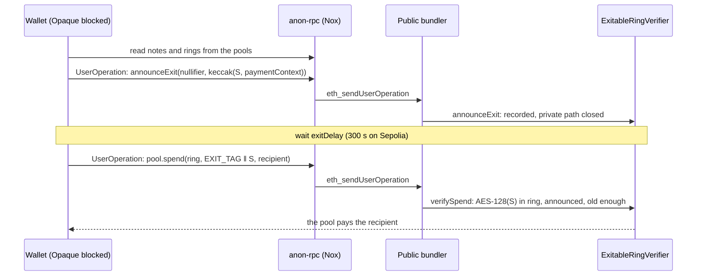

<div align="center">

# Ethereum Foundation: CROPS, anon-rpc and EIP-8141

### A wallet you can leave without us, reads nobody can trace, payees hidden against quantum computers, and transactions signed by a hash-based key alone.

[](#crops-stated-plainly)
[](https://ethereum.github.io/anon-rpc/)
[](#s-eip-8141-a-transaction-signed-by-forsc-alone)

</div>

## Contents

1. [Why this matters](#why-this-matters)
2. [anon-rpc: reads nobody can trace](#anon-rpc-reads-nobody-can-trace)
3. [C: your money leaves without us](#c-your-money-leaves-without-us)
4. [P: who was paid is hidden too, against quantum computers as well](#p-who-was-paid-is-hidden-too-against-quantum-computers-as-well)
5. [P: who paid is hidden: the private path](#p-who-paid-is-hidden-the-private-path)
6. [S: EIP-8141, a transaction signed by FORS+C alone](#s-eip-8141-a-transaction-signed-by-forsc-alone)
7. [CROPS, stated plainly](#crops-stated-plainly)
8. [Deployment addresses](#deployment-addresses)
9. [Reproduce it](#reproduce-it)
10. [Drafts for the ecosystem](#drafts-for-the-ecosystem)
11. [Where the code is](#where-the-code-is)

## Why this matters

- **Privacy has to be post-quantum today, not on the day a quantum computer arrives.** Chain data is permanent. A stealth payment hidden today with elliptic-curve Diffie-Hellman (ERC-5564's secp256k1 scheme 1) can be opened the day secp256k1 falls. Every payment ever announced becomes linkable at once.
- **Privacy that depends on one operator is a promise, not a property.** A wallet whose withdrawals need its operator's signature can be switched off or made to refuse.
- **"Who asked" leaks as much as "who paid".** An RPC provider that sees a wallet's reads sees which addresses that IP cares about, whatever the pool hides.

## anon-rpc: reads nobody can trace

**How it works in the wallet** ([`frontend/src/lib/anon-rpc.ts`](../../frontend/src/lib/anon-rpc.ts)):
1. The harness reads the anonymizing network's **worker bundle hash** from its on-chain specifier. For the Nox mixnet that's `0x35133267A8F7EC35046a83DCA0f4Ca8A6e1b7A9A` on Sepolia.
2. It runs only bytes whose keccak256 matches, in a Web Worker inside a sandboxed, null-origin iframe. The worker never sees the page, its storage or its keys.
3. It hands back a `fetch` that leaves through the network. An RPC or bundler answering through it sees the network's exit, never the browser.

**What goes through it:**

| Traffic | When |
|---|---|
| Every ENS lookup (UniversalResolverV2 `eth_call`s) | Always |
| The account's reads and UserOperations: `STATE`, `ESTIMATE`, `SUBMIT_USER_OPERATION`, `USER_OPERATION_RECEIPT` | With the Privacy view's switch on. They're answered **in the browser** by the same code Opaque's exit runs (`createWalletRpcAnswerer`), pointed at a public RPC and Pimlico's public bundler through `anonFetch`. |
| The whole exit (below) | When Opaque's servers are unreachable, or always, for the exit |

**What still crosses Opaque's mesh,** because only our exit can do it:
- private payments, since they need our attester;
- relayed key rotations;
- stealth announcements and their sweep gas.

**Checked by [`e2e-sepolia.ts`](../../backend/scripts/e2e-sepolia.ts):** with the switch on, no RPC or bundler request from the browser named the account. Only 2 direct requests left the browser, one of them anon-rpc's own bootstrap read of its specifier. The Privacy view counts every request anon-rpc answered.

## C: your money leaves without us

**Before,** every withdrawal from an Opaque pool needed Opaque's attester to sign it. **Now** each Sepolia pool's verifier is [`ExitableRingVerifier`](../../contracts/src/opaque/pool/ExitableRingVerifier.sol). The private path is the audited `AttestedRingVerifier`'s, unchanged. Beside it, a note's owner can always withdraw alone, after a public delay.

**The note, on chain.** A note is a 16-byte secret `S`. Its commitment and nullifier are AES-128 encryptions of the pool's two public blocks under `S`, exactly as the ring proof derives them:

```solidity
commitment = AES128.encrypt(S, noteBlock)      // what the deposit put in the ring
nullifier  = AES128.encrypt(S, nullifierBlock) // what spending it reveals
```

[`AES128.sol`](../../contracts/src/opaque/lib/AES128.sol) does that on chain. It's checked byte for byte against the wallet's own derivation.

**The exit, in two steps:**
1. **`announceExit(nullifier, claim)`**, where `claim = keccak256(abi.encode(S, pool.paymentContext(recipient)))`.
   - It records `announcedAt[nullifier][claim] = now`, sets `exiting[nullifier] = true`, and emits `ExitAnnounced(nullifier, claim, payableAt)`.
   - It binds the payout, and reveals nothing about which deposit the note is. Anyone may send it.
   - Announcing again is refused (`AlreadyAnnounced`).
2. **After `exitDelay`** (300 s on Sepolia; days for a real pool), the pool's `spend` is called with `proof = EXIT_TAG ‖ S`, where `EXIT_TAG = keccak256("opaque/v1/ring-exit")`. `verifySpend`:
   1. recomputes the commitment and nullifier from `S`, with AES-128;
   2. checks the commitment is in the 8-member ring (`NotInRing`, `WrongRingSize`);
   3. checks the announcement for exactly this secret and payout exists (`NotAnnounced`) and is old enough (`TooEarly(payableAt)`);
   4. emits `Exited(nullifier, commitment)` and returns the nullifier, so the pool marks it spent and pays.

**Why it can't be raced:**
- Once a nullifier is announced, its private path is closed: any non-exit spend of it reverts with `NoteIsExiting`. A secret revealed in step 2 can't be run through the attester.
- Racing step 2 would need an announcement of the racer's own, `exitDelay` old, for a secret they hadn't seen.
- Announcing someone else's nullifier needs that nullifier, which stays secret until its note is spent.

**The wallet does all of it with no Opaque server** ([`without-opaque.ts`](../../frontend/src/lib/without-opaque.ts), [`backend/chain/ring-exit.ts`](../../backend/chain/ring-exit.ts)):
- It reads the notes and rings from the chain through anon-rpc.
- It sends both steps as UserOperations its FORS+C key signs, to a public bundler, through anon-rpc.

**Proof:** `e2e-sepolia.ts` blocks every Opaque host in the browser. The wallet offers the way out instead of a dead end. It reads its notes through anon-rpc, then announces, waits and withdraws a 50 tUSDC note. The receiving address gets it, and no RPC or bundler saw the account.



## P: who was paid is hidden too, against quantum computers as well

Post-quantum stealth payments, on the **standard** contracts ([`backend/chain/stealth.ts`](../../backend/chain/stealth.ts), [`frontend/src/lib/stealth.ts`](../../frontend/src/lib/stealth.ts)):

- **The scheme:** `SCHEME_ID = keccak256("opaque/v1/stealth/ml-kem-768/fors-c")`, a scheme id of its own in ERC-5564's space.
- **Turning it on:**
  - the wallet draws an ML-KEM-768 key pair from its recovery phrase;
  - it publishes the 1,184-byte encapsulation key with ERC-6538's `registerKeys(SCHEME_ID, metaAddress)`, in the same signature as claiming `name.opaque.eth`;
  - turning it off publishes an empty one.
- **Paying:**
  1. The payer reads the payee's meta-address and encapsulates to it. This gives a 1,088-byte ciphertext and a shared secret `ss`.
  2. `ss` draws **both** FORS+C keys (active and next) of a fresh `PQAccount`. The payer computes its counterfactual address through the factory (CREATE2, 32 uses per key).
  3. The pool pays that address.
  4. The announcement goes on ERC-5564's Announcer, with a view tag, the first byte of `keccak256("opaque/v1/stealth/view-tag" ‖ ss)`. Opaque's exit posts it, so the payer's own address isn't on the announcement.
- **Finding and sweeping:**
  - the payee's wallet scans announcements (pages of 8, 10,000-block windows, 6 blocks behind the head so a lagging node can't skip one);
  - the view tag skips 255 in 256 without decapsulating;
  - the wallet decapsulates its own, finds the account, and **sweeps** the payment into its own notes. The one-time account's first UserOperation deploys it and deposits.
  - Opaque's exit gives each announced account holding at least 1 USDC 0.008 ETH of sweep gas, once.
- **Why ML-KEM:** secp256k1 stealth addresses hide the payee from today's observers. A quantum computer reading the announcements later recomputes every shared secret and links every payment. With ML-KEM-768 (FIPS 203) it can't.
- **The cost of hash-based keys:** FORS+C keys have no algebra to tweak the way elliptic-curve keys do. So the payer also holds the one-time account's keys until the payee sweeps it. The wallet sweeps as soon as the payment lands, and shows which payments are final.

## P: who paid is hidden: the private path

- **Notes:** fixed-size notes sit in pools (tUSDC 1–100 and WETH 0.0005–0.005 ETH on Sepolia; pqUSDC 1–100 on the devnet).
- **Ring proof:** a payment proves it owns one note of 8 without saying which. The proof is a **ZKBoo ring proof** (MPC-in-the-head over AES-128, hash-based), built in a Web Worker, and the note's secret never leaves the page.
- **Transport:** the sealed intent travels through **three relays** with ML-KEM onion layers. No relay sees both the sender and the payment.
- **Settlement:** an attester checks the proof and the pool pays. The attester never learns which of the 8 notes paid.
- **The payer's account sends no transaction for the payment.** On chain, the pool pays, in a transaction sent by the settler.

## S: EIP-8141, a transaction signed by FORS+C alone

**On Sepolia,** each action is a UserOperation signed by the account's FORS+C key through ERC-4337. A bundler only carries it. **On the EIP-8141 devnet, the transaction itself is post-quantum.**

**[`FramePQAccount`](../../contracts/frame/FramePQAccount.sol), the account.**
- **The signature:** the transaction carries one `ARBITRARY` signature entry, the FORS+C signature. The protocol leaves that entry's bytes out of the signature hash, so the signature covers everything else, frames included.
- **`verify()`**, the VERIFY frame:
  1. `sigparam(0, SCHEME)` must be `ARBITRARY` (`WrongScheme`);
  2. the account must use its one linear nonce: keyed nonces (EIP-8250) would give one key many sequences, so `OnlyTheAccountNonce`;
  3. the nonce must fall in `[keyFirstNonce, keyFirstNonce + MAX_USES)`, else `KeyExhausted`. A VERIFY frame runs as a STATICCALL and can't count uses in storage, so **the protocol nonce counts them**;
  4. `SIGDATACOPY` copies the signature out, and `digest = keccak256(abi.encode(DOMAIN, sigHash))`. The key never signs a bare hash, so it can't be replayed for anything else;
  5. `LeanFors.recoverCommitment(signature, digest)` must equal the account's key, else `BadSignature`;
  6. `approve(EXECUTION_AND_PAYMENT)`.
- **SENDER frames** then call any contract with the account as `msg.sender`. The frames are the batch, so there's no `execute()`.
- **`rotate(next)`** is callable only from the account's own SENDER frame (`NotSelf`), so the current key signs the handover with everything else. It sets `keyFirstNonce = nonce + 1`.
- **Parameters:** k=13, a=13 keeps 128-bit forgery resistance for 8 signatures (`k·(a − log₂8) = 130`). It's also the set that fits the validation budget.

**[`FramePQAccountFactory`](../../contracts/frame/FramePQAccountFactory.sol): accounts with no signature at all.**
- The factory is the creating transaction's **sender** and pays for it.
- Its `verify()` approves only a transaction of exactly two frames, whose second is a SENDER frame to the factory itself with no value, calling `create(key)`. Otherwise it reverts with `OnlyCreate`.
- `create(key)` deploys `FramePQAccount` with CREATE2, salt = key. So `accountOf(key)` is known before the account exists, and a faucet can fund it first.

**It fits the public mempool's budget.**
- The devnet caps validation at `MAX_VERIFY_GAS` = 100,000 for every sender, staked or not. That covers the whole validation prefix: VERIFY frames plus signature costs.
- The audited `ForsVerifier` spends 167k at k=13, a=13. [`LeanFors`](../../contracts/src/ethereum/frame/LeanFors.sol) is the same function with its hot loop in assembly, reading the signature from memory, where `SIGDATACOPY` puts it.

| Parameters | `ForsVerifier` | `LeanFors` |
|---|---|---|
| k=13, a=13 | 167k | **53.6k** |
| k=32, a=8 | 260k | 83k |

- **A whole VERIFY frame used 76,430 gas**, under the public limit with room to spare. There's no special treatment, no private mempool and no whitelisting. That's the answer to the alt-mempool maintainers' question about why a heavy VERIFY frame is fine for the nodes that run it: ours isn't heavy.
- `test/LeanFors.t.sol` holds it to `ForsVerifier`: the same commitment on both fixtures, the same verdict on 1,024 fuzzed tamperings, and the same reverts.

**Everything else runs on the devnet too, with every signature FORS+C:**
- **Private payments:** pqUSDC notes in seven pools, ring proofs built in the page, three relays, and an attester that's itself a `FramePQAccount`. Its registry key signs each attestation and its frame keys pay for each `spend`.
- **Swaps:** Uniswap v4, in a pool only post-quantum accounts may use.
- **Names:** ENS resolved with ENSIP-11 (`0x80000539`).

**Found on the way:**
- **Dropped transactions:** the alt mempool sometimes drops a transaction it accepted. FORS signing is deterministic, so the wallet re-broadcasts the **same bytes** to the gateway and the miner until they're mined. No key signs twice for one nonce.
- **Quotes:** ethrex refuses `eth_call` from a contract address, so quotes come from PoolManager storage.

**Try it:** [opaque.credit/testnet/devnet](https://www.opaque.credit/testnet/devnet), "Ethereum Devnet (Fully post-quantum)".

## CROPS, stated plainly

| | What we do | What we don't, yet |
|---|---|---|
| **C**, censorship resistance | Notes leave their pools with every Opaque server unreachable (exitable pools, anon-rpc, a public bundler). | Arc and XRPL pools have no such exit: a pool's verifier is fixed when it's deployed. Private *payments* still need our attester. |
| **O**, open source | [Apache-2.0](../../LICENSE). Contracts, wallet, extension and stack build and run from this repo alone. | Our hosted stack's secrets are ours. Anyone can run a stack with their own. |
| **P**, privacy | Ring of 8, a three-hop relay mesh, a fresh account per app, ML-KEM stealth payments, reads through anon-rpc, no analytics. | anon-rpc's bootstrap reads its specifier contract directly, once. An exit makes that one note public. Amounts are public. |
| **S**, security | FORS+C hash-based keys, sealed in the browser under the wallet password; few-time keys that rotate themselves; forge tests; the audited contracts unchanged. | The new contracts aren't audited. The relays are **one operator today; before mainnet they'll be run by multiple independent operators.** |

## Deployment addresses

**Sepolia** (full map: [`deployments/eth-sepolia.json`](../../deployments/eth-sepolia.json)):

| Contract | Address |
|---|---|
| Exitable pool, 1 tUSDC | [`0xf5408a8e98773ed5fded3decb805bd6cb10b8668`](https://sepolia.etherscan.io/address/0xf5408a8e98773ed5fded3decb805bd6cb10b8668) |
| Exitable pool, 2 tUSDC | [`0x73066fbfbbd97781d8a409017dd7fdfad0e3b268`](https://sepolia.etherscan.io/address/0x73066fbfbbd97781d8a409017dd7fdfad0e3b268) |
| Exitable pool, 5 tUSDC | [`0x5b0287f1b5b57dc50769551a9511faeaeb475d42`](https://sepolia.etherscan.io/address/0x5b0287f1b5b57dc50769551a9511faeaeb475d42) |
| Exitable pool, 10 tUSDC | [`0xb812a927daa8b22983737d689d1f3af649530ed9`](https://sepolia.etherscan.io/address/0xb812a927daa8b22983737d689d1f3af649530ed9) |
| Exitable pool, 20 tUSDC | [`0x9905c992d43c531b0973d25209877f448fd660cf`](https://sepolia.etherscan.io/address/0x9905c992d43c531b0973d25209877f448fd660cf) |
| Exitable pool, 50 tUSDC | [`0xa1b56dbc554bef4e9d6caecf0346a97f3102ff8b`](https://sepolia.etherscan.io/address/0xa1b56dbc554bef4e9d6caecf0346a97f3102ff8b) |
| Exitable pool, 100 tUSDC | [`0x839dde4a593a4f669540efc8d699ae66118fc25c`](https://sepolia.etherscan.io/address/0x839dde4a593a4f669540efc8d699ae66118fc25c) |
| Exitable pool, 0.0005 ETH (WETH) | [`0x68c22d3c8f50f72c51bce410d5a658a3c50c9919`](https://sepolia.etherscan.io/address/0x68c22d3c8f50f72c51bce410d5a658a3c50c9919) |
| Exitable pool, 0.001 ETH (WETH) | [`0x04d4fb05dc905163ea28b6d7a5d869ab11b480dd`](https://sepolia.etherscan.io/address/0x04d4fb05dc905163ea28b6d7a5d869ab11b480dd) |
| Exitable pool, 0.005 ETH (WETH) | [`0xed9ad8f64a4656427d28dd0b864058d5267bf0dc`](https://sepolia.etherscan.io/address/0xed9ad8f64a4656427d28dd0b864058d5267bf0dc) |
| `PQKeyRegistry` | [`0x8b47560d32bcda788ab5233ab2bda55204cacca3`](https://sepolia.etherscan.io/address/0x8b47560d32bcda788ab5233ab2bda55204cacca3) |
| `PQAccountFactory` / `PQAccount` implementation | [`0xe5931be6e8ec9a689f96d4de767f73718bdab08f`](https://sepolia.etherscan.io/address/0xe5931be6e8ec9a689f96d4de767f73718bdab08f) / [`0x17fc96e5b93eb031b2db2aac415dd507ad932dbf`](https://sepolia.etherscan.io/address/0x17fc96e5b93eb031b2db2aac415dd507ad932dbf) |
| ERC-6538 registry / ERC-5564 Announcer (the standard ones) | [`0x6538e6bf4b0ebd30a8ea093027ac2422ce5d6538`](https://sepolia.etherscan.io/address/0x6538e6bf4b0ebd30a8ea093027ac2422ce5d6538) / [`0x55649e01b5df198d18d95b5cc5051630cfd45564`](https://sepolia.etherscan.io/address/0x55649e01b5df198d18d95b5cc5051630cfd45564) |
| Nox mixnet specifier (anon-rpc's, not ours) | [`0x35133267A8F7EC35046a83DCA0f4Ca8A6e1b7A9A`](https://sepolia.etherscan.io/address/0x35133267A8F7EC35046a83DCA0f4Ca8A6e1b7A9A) |

Each pool's exit waits 300 s on Sepolia.

**EIP-8141 devnet, chain 1337** (full map: [`deployments/eth-devnet.json`](../../deployments/eth-devnet.json); explorer: [altmempoolexplorer.forshtat.com](https://altmempoolexplorer.forshtat.com)):

| Contract | Address |
|---|---|
| `FramePQAccountFactory` (accounts with no signature) | `0xd254366DeE9D4D2dE2F11982cabEAF94a16a3e0C` |
| `DevnetFaucet` (Opaque's devnet ETH) | `0x4F4b98A8f60Daaeee8D6a0D82a612003f3eaEec2` |
| `PQKeyRegistry` (devnet) | `0xbd9e98b96748f9a8083239d7ece0e9671483038f` |
| pqUSDC | `0xcd4b05a82c3e9a74d1f99bb688c359b8bea66037` |
| `TokenFaucet` (pqUSDC) | `0x786d0107d731e06a1c84f178a099a8b3e94c359f` |
| The attester, itself a FramePQAccount | `0x058fc5752b063765946af729311bae7ce032e3a2` |
| Seven pqUSDC privacy pools (1 to 100) | under `privacy.pools` |

## Reproduce it

```bash
cd contracts && forge test                                   # 142 pass, incl. LeanFors and ExitableRingVerifier
cd backend && node --use-system-ca scripts/e2e-sepolia.ts    # 33 checks: stealth, anon-rpc, the exit with Opaque blocked
cd backend && node --use-system-ca scripts/e2e-devnet-private.ts   # a private payment on the devnet, every signature FORS+C
cd backend && node ethereum/frame-tx.ts send                 # a FORS+C-only frame transaction
cd backend && node ethereum/frame-tx.ts attack               # another key's signature: refused at admission, BadSignature
```

## Drafts for the ecosystem

- [`docs/mumbai/erc-exitable-pools.md`](../../docs/mumbai/erc-exitable-pools.md): an ERC draft for exitable privacy pools: announce, delay, reveal, with the private path closed on announcement.
- [`docs/mumbai/anon-rpc-adopter.md`](../../docs/mumbai/anon-rpc-adopter.md): Opaque's entry for anon-rpc's `adopters.json5`. We'd be its first wallet.

## Where the code is

| File | What |
|---|---|
| [`contracts/src/opaque/pool/ExitableRingVerifier.sol`](../../contracts/src/opaque/pool/ExitableRingVerifier.sol), [`contracts/src/opaque/lib/AES128.sol`](../../contracts/src/opaque/lib/AES128.sol) | The exit, on chain |
| [`contracts/frame/`](../../contracts/frame/) | `FramePQAccount`, its factory and the devnet faucets ([folder README](../../contracts/frame/README.md)) |
| [`contracts/src/ethereum/frame/LeanFors.sol`](../../contracts/src/ethereum/frame/LeanFors.sol) | FORS+C verification at 53.6k gas ([folder README](../../contracts/src/ethereum/frame/README.md)) |
| [`backend/chain/stealth.ts`](../../backend/chain/stealth.ts), [`frontend/src/lib/stealth.ts`](../../frontend/src/lib/stealth.ts) | Post-quantum stealth payments |
| [`frontend/src/lib/anon-rpc.ts`](../../frontend/src/lib/anon-rpc.ts), [`frontend/src/lib/without-opaque.ts`](../../frontend/src/lib/without-opaque.ts), [`backend/chain/ring-exit.ts`](../../backend/chain/ring-exit.ts) | anon-rpc and the exit, in the wallet |
| [`backend/ethereum/frame.ts`](../../backend/ethereum/frame.ts), [`frame-tx.ts`](../../backend/ethereum/frame-tx.ts), [`devnet-stack.ts`](../../backend/ethereum/devnet-stack.ts) | The devnet's frame transactions and privacy stack |

[ETHGlobal Mumbai partners](README.md) · [All partner evidence](../README.md) · [Main README](../../README.md)
