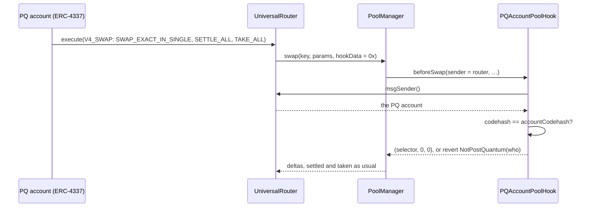
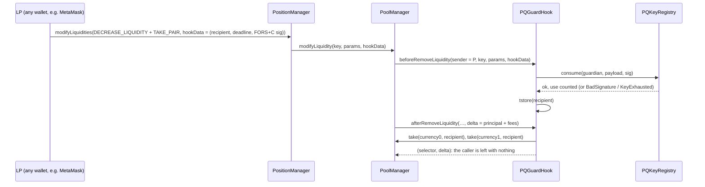

<div align="center">

# Uniswap v4: liquidity a quantum computer can't take

### Three v4 hooks that move pool authority to a hash-based key. Live at Uniswap's own v4 on Sepolia, and on the EIP-8141 devnet.

[](https://sepolia.etherscan.io/address/0xd0cfd61eb5ef783f6d70ea83b58d2c87fc034b01)
[](../../contracts/src/ethereum/uniswap/)
[](../../contracts/test/)

</div>


## Contents

1. [Why this matters](#why-this-matters)
2. [The three hooks](#the-three-hooks)
3. [How v4 decides which callbacks to call: the flags](#how-v4-decides-which-callbacks-to-call-the-flags)
4. [Every callback, hook by hook](#every-callback-hook-by-hook), including [`beforeSwap`](#beforeswap-in-detail) and [why there's no `afterSwap`](#why-theres-no-afterswap)
5. [Who is acting: `actor(sender)`](#who-is-acting-actorsender)
6. [`PQAccountPoolHook` (Sepolia)](#pqaccountpoolhook-sepolia-post-quantum-accounts-only)
7. [`PQPoolHook` (EIP-8141 devnet)](#pqpoolhook-eip-8141-devnet-the-same-rule-for-frame-accounts)
8. [`PQGuardHook` (Sepolia)](#pqguardhook-sepolia-a-forsc-second-factor-for-any-lp)
9. [The flows](#the-flows)
10. [How the wallet and scripts call them](#how-the-wallet-and-scripts-call-them)
11. [Errors and events](#errors-and-events)
12. [Deployment addresses](#deployment-addresses)
13. [What it shows on chain](#what-it-shows-on-chain)
14. [Where the code is](#where-the-code-is)
15. [The boundary](#the-boundary)

## Why this matters

A liquidity position can sit in a pool for years, and today one ECDSA key decides where it goes. That key's public key went on chain with its first transaction. On the day a large quantum computer can derive private keys, every position held by an ECDSA wallet can be removed by someone else. LPs are the slowest money to move and the easiest to find.

A v4 hook decides who may add, remove, swap and donate. So a hook can make a pool's authority post-quantum **now**, at the pool, with no change to Ethereum's account layer and none to Uniswap's core.

## The three hooks

| Hook | Network | What it enforces | Flags |
|---|---|---|---|
| **`PQGuardHook`** | Sepolia | A FORS+C second factor for **any** LP, MetaMask wallets included. A removal needs a post-quantum signature that names its recipient, and the hook pays only that recipient. | `0xB01` |
| **`PQAccountPoolHook`** | Sepolia | A pool only Opaque's ERC-4337 post-quantum accounts can swap in, add to, remove from or donate to. Admission is by code hash, with nothing to register. | `0xAA0` |
| **`PQPoolHook`** | EIP-8141 devnet | The same pool for EIP-8141 `FramePQAccount`s. An account is admitted once, by its CREATE2 address, and stays admitted when its key rotates. | `0xAA0` |

## How v4 decides which callbacks to call: the flags

The PoolManager reads a hook's permissions from the **lowest 14 bits of the hook's own address** (v4's `Hooks.sol`). A bit set to 1 means the PoolManager calls that function. A bit set to 0 means it never does. So the flags can't be changed after deployment: a different set of callbacks is a different address. Each hook's constructor checks its own address and reverts with `WrongHookAddress()` if the bits differ from its `FLAGS`. That's why each salt was mined for the CREATE2 deployer `0x4e59b44847b379578588920ca78fbf26c0b4956c`.

| Bit | v4 flag | `PQGuardHook` | `PQAccountPoolHook` / `PQPoolHook` |
|---|---|:---:|:---:|
| 13 | `beforeInitialize` | 0 | 0 |
| 12 | `afterInitialize` | 0 | 0 |
| 11 | `beforeAddLiquidity` | **1** | **1** |
| 10 | `afterAddLiquidity` | 0 | 0 |
| 9 | `beforeRemoveLiquidity` | **1** | **1** |
| 8 | `afterRemoveLiquidity` | **1** | 0 |
| 7 | `beforeSwap` | 0 | **1** |
| 6 | `afterSwap` | 0 | 0 |
| 5 | `beforeDonate` | 0 | **1** |
| 4 | `afterDonate` | 0 | 0 |
| 3 | `beforeSwapReturnDelta` | 0 | 0 |
| 2 | `afterSwapReturnDelta` | 0 | 0 |
| 1 | `afterAddLiquidityReturnDelta` | 0 | 0 |
| 0 | `afterRemoveLiquidityReturnDelta` | **1** | 0 |
| | **`FLAGS`** | `(1<<11)\|(1<<9)\|(1<<8)\|(1<<0)` = **`0xB01`** | `(1<<11)\|(1<<9)\|(1<<7)\|(1<<5)` = **`0xAA0`** |

You can check the flags in the deployed addresses (`address & 0x3FFF`):

| Hook | Address | Low 14 bits |
|---|---|---|
| `PQGuardHook` | `0xd0cf…4b01` | `0x4b01 & 0x3fff` = `0x0b01` |
| `PQAccountPoolHook` | `0xa68b…4aa0` | `0x4aa0 & 0x3fff` = `0x0aa0` |
| `PQPoolHook` | `0x3B28…caa0` | `0xcaa0 & 0x3fff` = `0x0aa0` |

- **Why the guard leaves swaps open:** it protects **liquidity**, and anyone may trade against a guarded pool.
- **Why the post-quantum pools gate swaps and donations as well:** a cracked ECDSA key must not be able to touch them in any way.
- **Why no `afterSwap`:** nothing has to happen after a swap, so the hooks never add work to one.

## Every callback, hook by hook

Every function a v4 hook can implement, with the signature the PoolManager calls, what it must return, and what each of our hooks does with it. "Not called" means the hook's address has that bit at 0, so the PoolManager never calls it, and the function doesn't exist in the contract.

| Callback | Bit | `PQAccountPoolHook` / `PQPoolHook` | `PQGuardHook` |
|---|---|---|---|
| `beforeInitialize(sender, key, sqrtPriceX96) → bytes4` | 13 | Not called. Anyone may initialize a pool that names the hook; its rules bind from the first liquidity or trade. | Not called |
| `afterInitialize(sender, key, sqrtPriceX96, tick) → bytes4` | 12 | Not called | Not called |
| `beforeAddLiquidity(sender, key, params, hookData) → bytes4` | 11 | **Called.** The actor must be post-quantum, else `NotPostQuantum(who)`. | **Called.** On a position's first funding, binds it to its funder's FORS+C key, else `NoGuardKey(who)`. |
| `afterAddLiquidity(sender, key, params, delta, feesAccrued, hookData) → (bytes4, BalanceDelta)` | 10 | Not called | Not called |
| `beforeRemoveLiquidity(sender, key, params, hookData) → bytes4` | 9 | **Called.** The actor must be post-quantum. | **Called.** Verifies the FORS+C signature in `hookData` through `PQKeyRegistry.consume`, and stores the signed recipient in transient storage. |
| `afterRemoveLiquidity(sender, key, params, delta, feesAccrued, hookData) → (bytes4, BalanceDelta)` | 8 | Not called | **Called.** Takes everything the removal released to the signed recipient, and returns that delta as the hook's. |
| `beforeSwap(sender, key, params, hookData) → (bytes4, BeforeSwapDelta, uint24)` | 7 | **Called.** The actor must be post-quantum. Returns `(selector, 0, 0)`. | Not called: anyone may trade in a guarded pool. |
| `afterSwap(sender, key, params, delta, hookData) → (bytes4, int128)` | 6 | Not called (see below) | Not called |
| `beforeDonate(sender, key, amount0, amount1, hookData) → bytes4` | 5 | **Called.** The actor must be post-quantum. | Not called |
| `afterDonate(sender, key, amount0, amount1, hookData) → bytes4` | 4 | Not called | Not called |
| `beforeSwapReturnDelta` | 3 | Off: the hook never changes a swap's amounts | Off |
| `afterSwapReturnDelta` | 2 | Off | Off |
| `afterAddLiquidityReturnDelta` | 1 | Off | Off |
| `afterRemoveLiquidityReturnDelta` | 0 | Off | **On.** The delta `afterRemoveLiquidity` returns is the hook's claim, so the caller receives nothing. |

### `beforeSwap`, in detail

- **When it runs:** the PoolManager calls `beforeSwap` inside `swap`, before it moves the price or any balance. The `sender` is the contract that called `swap`, here the Universal Router.
- **What our hooks check:** `msg.sender` is the PoolManager. Then `actor(sender)`, the account that called the router, must be post-quantum:
  - `PQAccountPoolHook`: its code is the `PQAccount` clone;
  - `PQPoolHook`: it was registered from the frame-account factory.
  
  Otherwise the call reverts with `NotPostQuantum(who)`, and the whole swap reverts with it.
- **What it returns:** `(this.beforeSwap.selector, 0, 0)`.
  - **`BeforeSwapDelta = 0`:** the hook takes no part of the swap and adds none, so the swap's amounts and price are exactly the pool's own. This is also why `beforeSwapReturnDelta` is off.
  - **`lpFeeOverride = 0`:** no override. v4 honors an override only for dynamic-fee pools that set its override flag. Our pools have a fixed 0.30% fee, so the pool's own fee applies.
- **`view`:** it reads and writes no storage, so a passing swap costs one extra call and one `msgSender()` or `codehash` read.

### Why there's no `afterSwap`

- **A gate belongs before the swap.** `afterSwap` runs after the PoolManager has already computed the swap and changed the pool's state. Refusing there would still revert, but only after all that work.
- **Checking in `beforeSwap`** refuses an ECDSA caller first, at the cheapest point, before anything moves.
- **Nothing needs doing after a swap:** the hooks take no fee, keep no oracle and settle nothing. So `afterSwap` and `afterSwapReturnDelta` stay off, and a passing swap runs exactly as in a hookless pool.
- **The guard has neither swap callback:** it protects liquidity, not trading.

The tests behind this: `test_a_pq_account_swaps_and_an_ecdsa_wallet_does_not` (Sepolia rule) and `test_an_ecdsa_wallet_cannot_swap_provide_or_withdraw` (devnet rule). On chain, an ECDSA wallet's swap through Uniswap's own Universal Router reverts with `NotPostQuantum(wallet)`, on Sepolia and on the devnet.

## Who is acting: `actor(sender)`

Every callback receives `sender`, the contract that called the PoolManager. For a person using Uniswap's own periphery, that's the PositionManager or the Universal Router, not the person. Both report the address that called them while they hold the PoolManager's lock, through `msgSender()`. So the hooks resolve the real caller like this:

```solidity
function actor(address sender) public view returns (address) {
    return sender == positionManager || sender == router ? IMsgSender(sender).msgSender() : sender;
}
```

- **Through Uniswap's own PositionManager or Universal Router:** the person who called them.
- **Any other router** counts as itself. A third-party contract can't name someone else as the actor, because it isn't asked. Its own address is checked, and that fails unless the router is itself a post-quantum account. The test is `test_another_router_counts_as_itself_not_as_whoever_it_names`.
- **`PQGuardHook`** resolves only through the PositionManager. Liquidity is managed there, and the guard doesn't gate swaps.

## `PQAccountPoolHook` (Sepolia): post-quantum accounts only

- **Admission, with no registry and no list:** `isPostQuantum(who)` is `who.codehash == accountCodehash`. `accountCodehash` is fixed in the constructor as `keccak256` of the EIP-1167 runtime code that points at Opaque's `PQAccount` implementation (`363d3d37…73 ‖ implementation ‖ 5af43d82…`). Every Opaque account is such a clone, and a clone's only authority is its FORS+C key in `PQKeyRegistry`. So the code hash says what the account is.
- **An account that isn't deployed yet** has no code, so it's refused. Its first UserOperation deploys it and can trade in the same operation, which is how the demo funded the pool.
- **Every callback** (`beforeAddLiquidity`, `beforeRemoveLiquidity`, `beforeSwap`, `beforeDonate`) runs the same check, `_only(sender)`:
  1. `msg.sender` must be the PoolManager, else `NotThePoolManager()`;
  2. `who = actor(sender)` must pass `isPostQuantum(who)`, else `NotPostQuantum(who)`;
  3. it returns the callback's selector. `beforeSwap` returns `(selector, 0, 0)`: no `BeforeSwapDelta` and no LP-fee override, so the pool's own 0.30% fee applies and the swap's amounts are untouched.
- **The callbacks are `view`:** no storage is written during a swap or a liquidity change.
- **A position moved to an ECDSA wallet freezes.** Its removal fails the same check. It doesn't leave the pool.

## `PQPoolHook` (EIP-8141 devnet): the same rule for frame accounts

- A `FramePQAccount` is created by `FramePQAccountFactory` at a CREATE2 address derived from its **first** FORS+C key.
- `register(bytes32 firstKey)` reads `factory.accountOf(firstKey)`. If code exists there (`NotAnAccount()` otherwise), it sets `isPostQuantum[account] = true` and emits `Registered(account, firstKey)`.
- **Anyone may register any account,** and nothing else can be admitted. The CREATE2 address commits to the factory's code and the key, so only a real `FramePQAccount` lives there.
- The account **stays admitted after it rotates its key**, because admission is by address, not by current key.
- **The callbacks** are the same four as `PQAccountPoolHook`, with the same `_only` check and the same return values.
- **In the wallet:** the devnet page's Swap registers the account in the same FORS-signed frame transaction as its first swap.

## `PQGuardHook` (Sepolia): a FORS+C second factor for any LP

**State.**
- `guardianOf[position]`: the account whose FORS+C key signs a position's removals.
- One transient slot, `RECIPIENT_SLOT = keccak256("opaque/v1/uniswap/remove/recipient")`. It holds the signed recipient between `beforeRemoveLiquidity` and `afterRemoveLiquidity` within one call, and is cleared after.

**The position's identity** is v4's own:

```solidity
positionOf(owner, key, params) = keccak256(abi.encode(keccak256(abi.encode(key)), owner, params.tickLower, params.tickUpper, params.salt))
```

Through the PositionManager, `owner` is the PositionManager and `salt` is the position's token id. So the hook binds an NFT position, wherever the NFT goes.

**1. `beforeAddLiquidity`: bind the position on its first funding.**
- If `guardianOf[position]` is empty, the guardian is `actor(sender)`, the wallet that called the PositionManager.
- That wallet must already hold a FORS+C key in `PQKeyRegistry` (`registry.stateOf(guardian).pkCommitment != 0`), else `NoGuardKey(guardian)`. Any wallet registers one with an ordinary transaction, `register(pk, next, maxUses, deadline)`.
- Then `guardianOf[position] = guardian`, and `Guarded(position, guardian)` is emitted.
- Later adds don't rebind: a position keeps the key it was opened with, even if the NFT is transferred.

**2. `beforeRemoveLiquidity`: check the post-quantum signature.**
- The position must be bound, else `Unguarded()`.
- `hookData` is `abi.encode(address recipient, uint256 deadline, bytes signature)`. Past `deadline`, it reverts with `Expired()`.
- The hook calls `registry.consume(guardian, payload, signature)` with:

  ```solidity
  payload = abi.encode("opaque/v1/uniswap/remove", block.chainid, address(this), position, params.liquidityDelta, recipient, deadline)
  ```

- **The registry** prefixes the payload with its user-action domain (`"opaque/v1/pq-wallet/action"`). It hashes that together with the chain, the guardian's address, the FORS+C parameters and the key's **use count**, and recovers the signer's key commitment with `ForsVerifier`. It reverts with `BadSignature()` unless that commitment is the guardian's key, `KeyExhausted()` past the key's few-time bound, or `KeyDisabled()`. Then it increments the use count, so **each signature works once**.
- So the signature binds this hook, this chain, this position, the **exact** liquidity change, the recipient and the deadline.
- **Fee collection is a removal too** (`liquidityDelta = 0`), so collecting fees also needs a signature.
- Finally, `tstore(RECIPIENT_SLOT, recipient)`.

**3. `afterRemoveLiquidity`: pay the signed recipient, and only them.**
- `tload` the recipient, and clear the slot.
- `delta` is the `BalanceDelta` the removal released to its caller, principal and fees. It's split into `amount0 = int128(delta >> 128)` and `amount1 = int128(delta)`. Either being negative would mean the hook owes the pool, which a removal never does: `OwesThePool()`.
- `poolManager.take(currency0, recipient, amount0)` and `take(currency1, recipient, amount1)` pay the recipient directly. `Released(position, recipient, delta)` is emitted.
- It returns `(selector, delta)`. With `afterRemoveLiquidityReturnDelta` set, the returned delta is the hook's, so the **caller is left with nothing**. Their own `TAKE_PAIR` receives zero.

**Why this stops a quantum thief.** Someone who cracks the LP's ECDSA key can call the PositionManager as the LP, but:
- **with no signature, or one from another key:** `BadSignature`. Nothing comes out;
- **copying the LP's real signature from the mempool and changing the recipient:** the payload no longer matches, so `BadSignature`;
- **replaying it unchanged in their own transaction:** it pays the **LP's** recipient, not them. The signature is then used up;
- **moving the NFT to their own wallet:** the position stays bound to the original guardian's key.

## The flows

A swap in a post-quantum pool (Sepolia):



A guarded removal (Sepolia):



## How the wallet and scripts call them

Action bytes are from v4-periphery's `Actions.sol`, encoded in [`backend/ethereum/uniswap/uniswap-v4.ts`](../../backend/ethereum/uniswap/uniswap-v4.ts):

| Action | Commands | `hookData` |
|---|---|---|
| Swap (Universal Router `V4_SWAP`) | `SWAP_EXACT_IN_SINGLE` (0x06), `SETTLE_ALL` (0x0c), `TAKE_ALL` (0x0f) | `0x`. The post-quantum pools check the caller, not data. |
| Open a position (PositionManager) | `MINT_POSITION` (0x02), `SETTLE_PAIR` (0x0d), `SWEEP` (0x14) | `0x` |
| Guarded removal (PositionManager) | `DECREASE_LIQUIDITY` (0x01), `TAKE_PAIR` (0x11) | `abi.encode(recipient, deadline, signature)`, about 9 KB with the FORS+C signature |
| Quote (no transaction) | `PoolManager.extsload(slot)`: the pool's price and liquidity, read across Opaque's relay mesh and computed with the v4 swap step | n/a |

## Errors and events

| Contract | Errors | Events |
|---|---|---|
| `PQAccountPoolHook` | `WrongHookAddress()`, `NotThePoolManager()`, `NotPostQuantum(address who)` | none |
| `PQPoolHook` | `WrongHookAddress()`, `NotThePoolManager()`, `NotAnAccount()`, `NotPostQuantum(address who)` | `Registered(account, firstKey)` |
| `PQGuardHook` | `WrongHookAddress()`, `NotThePoolManager()`, `NoGuardKey(address who)`, `Unguarded()`, `Expired()`, `OwesThePool()`; from the registry: `BadSignature()`, `KeyExhausted()`, `KeyDisabled()`, `NotRegistered()` | `Guarded(position, guardian)`, `Released(position, recipient, delta)` |

## Deployment addresses

| Contract | Network | Address |
|---|---|---|
| `PQGuardHook` | Sepolia | [`0xd0cfd61eb5ef783f6d70ea83b58d2c87fc034b01`](https://sepolia.etherscan.io/address/0xd0cfd61eb5ef783f6d70ea83b58d2c87fc034b01) |
| `PQAccountPoolHook` | Sepolia | [`0xa68b63f17fe7926812d8591247b5a718a7244aa0`](https://sepolia.etherscan.io/address/0xa68b63f17fe7926812d8591247b5a718a7244aa0) |
| `PQKeyRegistry` (the guard keys) | Sepolia | [`0x8b47560d32bcda788ab5233ab2bda55204cacca3`](https://sepolia.etherscan.io/address/0x8b47560d32bcda788ab5233ab2bda55204cacca3) |
| `PQAccount` implementation (whose clones the pool admits) | Sepolia | [`0x17fc96e5b93eb031b2db2aac415dd507ad932dbf`](https://sepolia.etherscan.io/address/0x17fc96e5b93eb031b2db2aac415dd507ad932dbf) |
| Guarded position | Sepolia | PositionManager token **#41441** |
| Uniswap v4 PoolManager | Sepolia | [`0xe03a1074c86cfedd5c142c4f04f1a1536e203543`](https://sepolia.etherscan.io/address/0xe03a1074c86cfedd5c142c4f04f1a1536e203543) |
| Uniswap v4 PositionManager | Sepolia | [`0x429ba70129df741b2ca2a85bc3a2a3328e5c09b4`](https://sepolia.etherscan.io/address/0x429ba70129df741b2ca2a85bc3a2a3328e5c09b4) |
| Uniswap v4 Universal Router | Sepolia | [`0x3a9d48ab9751398bbfa63ad67599bb04e4bdf98b`](https://sepolia.etherscan.io/address/0x3a9d48ab9751398bbfa63ad67599bb04e4bdf98b) |
| `PQPoolHook` | EIP-8141 devnet | `0x3B288a191c20c0333c06E90b386b611d2AC3caa0` |
| `FramePQAccountFactory` (its `accountOf`) | EIP-8141 devnet | `0xd254366DeE9D4D2dE2F11982cabEAF94a16a3e0C` |
| Uniswap v4 PoolManager / PositionManager / Universal Router | EIP-8141 devnet | `0x6bF9Aa9c04fd001385742d61f6818C3236429848` / `0x5bF24B2CD6f4cc0057F4BeD53264d591620Af57B` / `0x5e2250a42608a5cc9f62e23ab24824ee25b5e2be` |

Both pools are ETH/token pairs at a 0.30% fee and tick spacing 60. Full maps: [`deployments/eth-sepolia.json`](../../deployments/eth-sepolia.json) and [`deployments/eth-devnet.json`](../../deployments/eth-devnet.json), under `uniswap`. Devnet explorer: [altmempoolexplorer.forshtat.com](https://altmempoolexplorer.forshtat.com).

## What it shows on chain

**Sepolia, at Uniswap's own v4:**
- A PQ account's first UserOperation deployed the account and funded the post-quantum pool. Its swap bought exactly the quoted amount.
- An ECDSA wallet's swap in that pool reverts with `NotPostQuantum(wallet)`.
- The guard, on position #41441, opened by an ordinary ECDSA wallet with a registered guard key:
  - another key's signature and the real signature replayed to another recipient are both refused, with `BadSignature`;
  - the signed removal paid 0.002 ETH and 3.999999 tUSDC to the recipient it named, and 0 to the caller.
- **The wallet swaps here.** The Swap tab at [opaque.credit/sepolia/app](https://www.opaque.credit/sepolia/app) quotes from the pool's storage and swaps in one UserOperation signed by the account's FORS+C key.

**EIP-8141 devnet:**
- `frame-tx.ts pqpool` made the pool in **one atomic FORS-signed frame transaction**: deploy the hook, register, initialize ETH/pqUSD under it, and add 0.1 ETH of liquidity.
- The account's swap bought 1.974316 pqUSD for 0.001 ETH, the exact quote from PoolManager storage.
- An ECDSA wallet's swap through the router reverts with `NotPostQuantum(wallet)`.

**Reproduce it:**

```bash
cd contracts && forge test --match-path 'test/PQ*Hook.t.sol'          # 15 tests
cd backend && OPAQUE_NETWORK=sepolia node --use-system-ca ethereum/uniswap/uniswap-sepolia.ts   # deploys, or shows every rule on chain
cd backend && node --use-system-ca scripts/e2e-sepolia.ts             # includes "swapped on Uniswap v4 from the page"
```

The tests:
- **`PQGuardHook.t.sol`** (8): v4's selectors; a position needs a guard key to be funded; without the FORS+C signature nothing comes out; a signed removal pays only its signed recipient, once; a late removal is refused; only the PoolManager may call. It also covers `PQAccountPoolHook`: a PQ account swaps and an ECDSA wallet doesn't, and a proxy to another implementation isn't admitted.
- **`PQPoolHook.t.sol`** (7): v4's selectors; an address without its permission bits is refused; only an existing factory account is admitted; a PQ account swaps and provides through Uniswap's periphery; an ECDSA wallet can't swap, provide or withdraw; another router counts as itself; only the PoolManager may call.

## Where the code is

| File | What |
|---|---|
| [`contracts/src/ethereum/uniswap/`](../../contracts/src/ethereum/uniswap/) | The three hooks ([folder README](../../contracts/src/ethereum/uniswap/README.md)) |
| [`contracts/test/uniswap/PQGuardHook.t.sol`](../../contracts/test/uniswap/PQGuardHook.t.sol), [`PQPoolHook.t.sol`](../../contracts/test/uniswap/PQPoolHook.t.sol) | 8 and 7 tests with real FORS+C signatures |
| [`backend/ethereum/uniswap/uniswap-v4.ts`](../../backend/ethereum/uniswap/uniswap-v4.ts) | Sepolia: pool keys, quotes from storage, swap, mint and decrease calls |
| [`backend/ethereum/uniswap/uniswap-sepolia.ts`](../../backend/ethereum/uniswap/uniswap-sepolia.ts) | Deploys the Sepolia hooks (salt mining) and proves each rule on chain |
| [`backend/ethereum/uniswap/uniswap.ts`](../../backend/ethereum/uniswap/uniswap.ts) | Devnet: v4 as SENDER frames of a FORS+C frame transaction |

## The boundary

- **What the hooks protect:** who may move liquidity and trade, in pools that use them. They don't protect an ECDSA wallet's other assets. That's what the [Q-Day vault](https://www.opaque.credit/sepolia/vault) and Opaque accounts are for.
- **Cost:** a FORS+C signature is about 9 KB of calldata. The guard asks for one only on removal, the rare action. Swaps in a guarded pool cost what they always did.
- **Keys:** each guard key signs a set number of times, then rotates through `PQKeyRegistry`'s committed next key.
- **Status:** tested with forge, not audited. Testnet only.

[ETHGlobal Mumbai partners](README.md) · [All partner evidence](../README.md) · [Main README](../../README.md)
